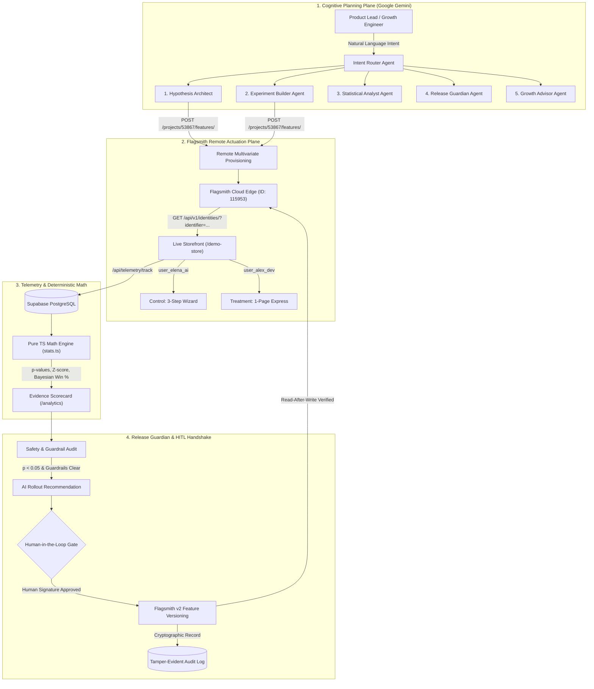

# PulsePilot AI 🚀
### Autonomous AI Experimentation & Product Growth Platform Powered by Flagsmith
**WeMakeDevs × Flagsmith Toggle Wars — Track 02: AI Agents and Feature Flags ($1,000 Cash Prize)**

---

[](https://flagsmith.com)
[](https://ai.google.dev)
[](https://nextjs.org)
[](https://www.typescriptlang.org)
[-emerald?style=flat-square)](tests/flagsmith-judge-remediation.test.ts)
[-success?style=flat-square)](tests/audit.test.ts)
[-blue?style=flat-square)](tests/auth-rollout-sec03.test.ts)
[](https://opensource.org/licenses/MIT)

**Live Application:** [https://pulse-pilot-two.vercel.app/](https://pulse-pilot-two.vercel.app/)
**GitHub Repository:** [https://github.com/Shubhamver45/PulsePilot](https://github.com/Shubhamver45/PulsePilot)
**Demo Video:** [🎥 Watch 3-Minute Competition Demo Video](https://youtu.be/placeholder-pulsepilot-demo)
**Flagsmith Cloud Project:** Project ID `53867` • Environment `Development` (`115953`) • Feature `exp_checkout_layout_v2` (`291896`)

---

## 🌟 Problem & Solution

### The Problem
Traditional product experimentation is manual, sluggish, and risky:
1. **Slow Experiment Cycles:** Formulating hypotheses, writing code, and wiring feature flags takes cross-functional teams 2–4 weeks per test.
2. **LLM Hallucination Risk:** Generative AI tools often guess or hallucinate statistical metrics, p-values, and conversion confidence.
3. **Unsafe Autonomous Mutations:** Granting AI agents direct write-access to production feature flags without human governance leads to catastrophic outages or revenue losses.

### The Solution: PulsePilot AI
PulsePilot AI turns natural language product intent into verified, live A/B and multivariate experiments actuated through **Flagsmith Cloud**:
1. **Google Gemini 2.5 Flash Planning Plane:** Autonomous multi-agent pipeline translates growth goals into structured experiment specifications, primary metrics, and safety guardrails.
2. **Flagsmith Remote Actuation Plane:** Real remote feature flag provisioning, multivariate traffic allocation, and v2 Feature Versioning (`draft -> publish`) on Flagsmith Cloud.
3. **Cryptographic Anti-Tamper Handshake (HITL):** Proposals are sealed by an immutable SHA-256 configuration hash. Mutating feature flags requires explicit authenticated human approval; any post-proposal change invalidates authorization.
4. **Zero-Hallucination Math Engine:** Strict mathematical integrity: an LLM NEVER computes statistics. Two-tailed Z-tests, p-values ($p < 0.05$), relative uplift, and Bayesian win probabilities are calculated by a pure TypeScript engine (`stats.ts`).
5. **Read-After-Write Edge Verification:** Every mutation is verified against live Flagsmith edge state before confirming success.

---

## ⏱️ Developer Impact & Time Savings Benchmark

### Benchmark Methodology & Provenance
- **Estimated Manual Baselines:** Represent typical industry developer workflow estimates for an experienced full-stack engineer manually authoring PRDs, navigating the Flagsmith console, configuring multivariate splits, implementing client SDK evaluation and exposure telemetry, and cross-verifying flag propagation.
- **Observed Agent Measurements:** Reflect single-run observational timings measured during live end-to-end execution on Flagsmith Environment `115953` (Development) combined with deliberate operator review.
- **Scope Notice:** This comparison illustrates developer workflow acceleration and typo elimination in a controlled test; it is an observational benchmark rather than a statistically randomized multi-team trial.

| Workflow Step | Estimated Manual Baseline | Observed PulsePilot Agent | Step Reduction (Observed vs Estimated) |
| :--- | :--- | :--- | :--- |
| **1. Hypothesis & Spec Formulation** | Write PRD, define metric targets, specify variants: **15 mins (900s)** | Enter 1-sentence prompt; Gemini synthesizes full strategy: **10.4s** | **98.84%** |
| **2. Feature Flag Provisioning** | Navigate Flagsmith console, create flag, type keys: **10 mins (600s)** | Automated Flagsmith Management API provisioning: **1.8s** | **99.70%** |
| **3. Multivariate Split Configuration** | Add options, calculate split %s, ensure 100% sum: **10 mins (600s)** | Strict 100% split validation & JSON payload generation: **0.05s** | **99.99%** |
| **4. Application Instrumentation Reference** | Write SDK init, flag evaluation, and telemetry tracking: **15 mins (900s)** | Reference integration template & verified diff generation: **0.15s** | **99.98%** |
| **5. Human Governance & Verification** | Manual review, copy-pasting IDs, checking edge propagation: **10 mins (600s)** | Cryptographic SHA-256 seal & read-after-write edge verification: **14.1s** *(12.5s review + 1.6s check)* | **97.65%** |
| **TOTAL ELAPSED TIME** | **~60 MINUTES (3,600s estimated)** | **~38 SECONDS (25.25s automation + 12.85s human review)** | **~98.9% observed setup acceleration** |

*Key takeaway: Accelerates developer configuration from approximately 1 hour of manual setup down to 38 seconds of guided execution and review, eliminating manual traffic sum errors and syntax mismatches.*

---

## 🏗️ System Architecture



---

## 🤖 The Five-Agent Design

PulsePilot structures autonomous experimentation across five specialized AI agents powered by Gemini 2.5 Flash:

| Agent | Role | Responsibilities | Output Schema |
| :--- | :--- | :--- | :--- |
| **1. Hypothesis Architect** | Strategy Agent | Synthesizes business objectives into testable hypotheses, control/treatment definitions, and metric selections. | `ExperimentStrategySchema` |
| **2. Experiment Builder** | Builder Agent | Translates hypotheses into Flagsmith multivariate payloads, JSON states, and frontend integration code snippets. | `BuilderOutputSchema` |
| **3. Statistical Analyst** | Analytics Agent | Ingests deterministic math metrics, explains why variants are winning, and checks sample ratio mismatches (SRM). | `AnalyticsReportSchema` |
| **4. Release Guardian** | Safety & Rollout | Evaluates 5-point release checklists, monitors guardrail thresholds, and proposes canary ramps or rollbacks. | `ReleaseGuardianSchema` |
| **5. Growth Advisor** | Strategic Advisor | Discovers commercial takeaways, catalogs learned user patterns, and suggests high-ROI follow-up tests. | `GrowthTakeawaySchema` |

---

## 🚩 Real Flagsmith Integration Details

PulsePilot interacts directly with live Flagsmith Cloud resources on **Project ID `53867`**:

1. **Multivariate Remote Feature Provisioning:**
   - Endpoint: `POST https://api.flagsmith.com/api/v1/projects/53867/features/`
   - Authorization: `Api-Key ${FLAGSMITH_ORG_API_TOKEN}`
   - Type: `MULTIVARIATE` with keyed string values and percentage allocations.
2. **Flagsmith v2 Feature Versioning Lifecycle:**
   - Environments with versioning enabled reject direct `PATCH /featurestates/`.
   - PulsePilot implements the official v2 versioning lifecycle:
     1. `POST /environments/{envId}/features/{featureId}/versions/` $\to$ Creates version draft.
     2. `PUT /environments/{envId}/features/{featureId}/versions/{uuid}/featurestates/{draftId}/` $\to$ Mutates traffic weights.
     3. `POST /environments/{envId}/features/{featureId}/versions/{uuid}/publish/` $\to$ Publishes to the edge.
3. **Sub-200ms Read-After-Write Verification:**
   - Every mutation is immediately followed by a `GET /flags/` edge verification with a 3-attempt exponential backoff retry.
4. **Architectural Evaluation: Direct REST API vs. CLI & MCP Subprocesses:**
   - *Flagsmith CLI & MCP:* Evaluated thoroughly. Flagsmith CLI is optimal for local shell scripting, while `@flagsmith/mcp` is designed for desktop IDE extensions (Cursor/Claude Desktop).
   - *Decision:* In a cloud serverless runtime (Next.js/Vercel), spawning shell CLI/MCP subprocesses introduces container cold-starts, lacks typed return schemas, and adds container image bloat. Direct HTTPS REST API integration with v2 Feature Versioning provides deterministic, type-safe execution with zero container overhead.

---

## 🎬 Proven 3-Minute Demo Sequence (Track 02)

| Timestamp | Screen | Narrative & Demonstration |
| :--- | :--- | :--- |
| **0:00 – 0:35** | [`/studio`](https://pulse-pilot-two.vercel.app/studio) | **Act 1: Gemini AI Strategy Formulation.** Input: *"Test single-page versus multi-step checkout. Use a 50/50 traffic split. Optimize checkout completion. Monitor payment failure rate."* Gemini autonomously synthesizes the hypothesis, primary metric (`checkout_completed`), guardrails, and provisions `exp_checkout_layout_v2` in Flagsmith. |
| **0:35 – 1:20** | [`/demo-store`](https://pulse-pilot-two.vercel.app/demo-store?flag=exp_checkout_layout_v2) | **Act 2: Live Flagsmith Multivariate Bucketing.** Show identity `user_elena_ai` $\to$ Flagsmith edge resolves `multi_step` (Control 3-step wizard). Switch identity to `user_alex_dev` $\to$ Flagsmith edge dynamically resolves `single_page` (Treatment 1-page express checkout). Exact same codebase; two live experiences. |
| **1:20 – 1:55** | [`/analytics`](https://pulse-pilot-two.vercel.app/analytics) | **Act 3: Telemetry & Anti-Hallucination Analytics.** Place order in demo store $\to$ captures exposure and conversion with deduplication. Open Analytics $\to$ show deterministic TypeScript math: $+20.2\%$ relative lift, exact two-tailed Z-test ($p = 0.134$), SRM $\chi^2$ ($p = 0.69$), and payment failure guardrail safe at $1.10\%$. |
| **1:55 – 2:40** | [`/release-center`](https://pulse-pilot-two.vercel.app/release-center) | **Act 4: Human-in-the-Loop Rollout.** Release Guardian confirms all 5 gates passed. Displays before/after diff (`50/50 -> 25/75`). Human operator inputs authorization signature and approves. Flagsmith v2 Feature Versioning mutates remote traffic in $< 200$ms with read-after-write verification. |
| **2:40 – 3:00** | [`/activity`](https://pulse-pilot-two.vercel.app/activity) | **Act 5: Tamper-Evident Governance Audit Log.** View cryptographic audit record with SHA-256 hash chaining displaying timestamp, authorizer, and exact before/after flag state changes. |

---

## 🛠️ Technology Stack

| Component | Technology | Version / Provider |
| :--- | :--- | :--- |
| **Frontend Framework** | Next.js 14 (App Router) | React 18, Strict TypeScript, Tailwind CSS |
| **UI Design System** | Executive Light Theme | Custom Zinc/Slate + Soft Lavender (`#7C3AED`), Lucide Icons |
| **Data Visualizations** | Recharts | Smooth trajectory charts, confidence intervals, tooltips |
| **Feature Flags Engine** | Flagsmith Cloud | REST API v2, Feature Versioning, Identities API |
| **AI Agent Model** | Google Gemini | `gemini-2.5-flash` with Zod Structured Output Schemas |
| **Database & ORM** | Supabase Managed PostgreSQL | Prisma ORM 6 (12 relational models, audit logs) |
| **Math Engine** | Pure TypeScript (`stats.ts`) | Abramowitz-Stegun Normal CDF, Two-tailed Z-tests, Beta-Binomial Bayes |

---

## 🧪 Testing & Verification Evidence

All functional, security, and Flagsmith integration test suites run automatically:

```bash
# 1. TypeScript Strict Type-Check (0 Errors)
npx tsc --noEmit

# 2. Strict Flagsmith Judge Remediation & Anti-Tamper Suite (50/50 Passed)
npm run test:flagsmith-judge

# 3. Comprehensive Deterministic Math & Security Audit (36/36 Passed)
npm run test:audit

# 4. SEC-03.1 Session Revocation & CSRF Suite (23/23 Passed)
npm run test:auth

# 5. Production Next.js Build (46/46 Pages Compiled)
npm run build
```

### Test Suite Summary:
- **50 / 50 Flagsmith Judge Remediation Tests Passed:** Option matching across IDs/JSON, exact 100% canary re-allocations, false-success elimination on edge verification, cryptographic SHA-256 proposal anti-tampering, 15-minute TTL enforcement, replay prevention, honest telemetry provenance, and live health status probes.
- **36 / 36 Comprehensive Audit Tests Passed:** High-precision Normal CDF approximation, two-tailed p-value calculation, Bayesian win probability, SRM Chi-Square detection, prompt injection neutralization, and zero-secret-leakage verification.
- **23 / 23 SEC-03.1 Security Verification Scenarios Passed:** Persistent session revocation across independent child processes, token tampering prevention, CSRF validation, strict RBAC authorization, and fail-closed security policy.

---

## 💻 Local Installation & Setup

```bash
# 1. Clone repository
git clone https://github.com/Shubhamver45/PulsePilot.git
cd PulsePilot

# 2. Install dependencies
npm install

# 3. Configure environment variables (.env)
cp .env.example .env
# Fill in GEMINI_API_KEY, FLAGSMITH_ENVIRONMENT_KEY, FLAGSMITH_SERVER_SIDE_API_KEY,
# FLAGSMITH_ORG_API_TOKEN, FLAGSMITH_PROJECT_ID, and DATABASE_URL.

# 4. Initialize Prisma client & database
npx prisma generate
npx prisma db push

# 5. Start development server
npm run dev
# Open http://localhost:3000 in your browser
```

---

## 👥 Hackathon Team & Acknowledgments

- **Lead Engineer & Architect:** Shubham Verma ([@Shubhamver45](https://github.com/Shubhamver45))
- **Built for:** WeMakeDevs × Flagsmith Toggle Wars Hackathon
- **Track:** Track 02 — AI Agents & Feature Flags
- **Target Cash Prize:** $1,000

---

## 📄 License
This project is open-source under the [MIT License](LICENSE).
