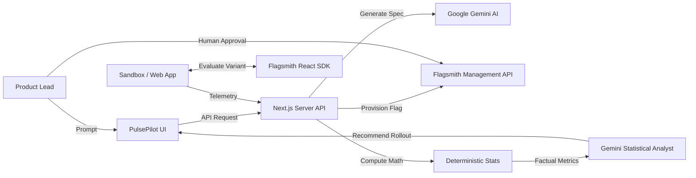

# PulsePilot AI 🚀
### Autonomous AI Experimentation & Product Growth Platform Powered by Flagsmith
**TOGGLE WARS Hackathon — Track 02: AI Agents and Feature Flags**

---

[](https://flagsmith.com)
[](https://ai.google.dev)
[](https://nextjs.org)
[](https://www.typescriptlang.org)
[](https://tailwindcss.com)
[](https://opensource.org/licenses/MIT)

---

## 🌟 Vision

**PulsePilot AI** is an autonomous experimentation and product growth co-pilot that turns natural language growth hypotheses into live feature flag experiments, measures real user behavior, performs deterministic statistical analysis, and recommends safe feature rollouts.

By using **Flagsmith as the actuation plane** and **Google Gemini as the cognitive planning and analysis plane**, PulsePilot AI demonstrates that **feature flags are the ideal, safe boundary for AI agents in modern software development**.

---

## ✨ Key Features

1. **Natural Language Experiment Formulation (Hypothesis Architect):**
   - Type an idea like *"Test social proof vs a 20% discount badge on checkout"*.
   - Gemini structures the hypothesis, defines primary and guardrail metrics, and generates multivariate feature flag configurations with JSON payloads.

2. **Automated Flagsmith Provisioning & Sync:**
   - Server-side provisioning of multivariate feature flags in Flagsmith with one click.
   - Client-side real-time flag evaluation via the Flagsmith React SDK.

3. **Deterministic Mathematical Engine (Zero Hallucinations):**
   - Pure TypeScript calculations for two-sample Z-tests, p-values, relative uplift, and Bayesian win probabilities.
   - The AI agent provides strategic interpretation of factual numbers—it is strictly prohibited from inventing statistics.

4. **Human-in-the-Loop (HITL) Safety & Rollout Strategist:**
   - AI generates rollout or rollback recommendations based on statistical confidence ($\ge 95\%$) and guardrail integrity.
   - An authenticated human must approve live production shifts to 100% or trigger the $< 500$ ms emergency kill-switch.

5. **Interactive Live Customer Sandbox:**
   - Embedded interactive checkout & pricing demo to test user traits, live flag evaluations, and conversion telemetry in real time.

6. **Executive Light Theme UI:**
   - Premium aesthetic inspired by Linear, Stripe, and Vercel: soft lavender accents (`#7C3AED`), subtle slate backgrounds, deep charcoal typography, and fluid micro-interactions.

---

## 🏗️ System Architecture



For complete architectural details, see [docs/SYSTEM_ARCHITECTURE.md](docs/SYSTEM_ARCHITECTURE.md).

---

## 📚 Project Documentation

- [Product Requirements Document (PRD)](docs/PRD.md)
- [System Architecture](docs/SYSTEM_ARCHITECTURE.md)
- [Database Schema & ERD](docs/DATABASE_SCHEMA.md)
- [AI Agent Design & Schemas](docs/AI_AGENT_DESIGN.md)
- [Flagsmith Integration Guide](docs/FLAGSMITH_INTEGRATION.md)
- [Security Architecture & Threat Model](docs/SECURITY.md)
- [Hackathon Demo Plan & Presentation Guide](docs/DEMO_PLAN.md)

---

## 🛠️ Technology Stack

| Layer | Technologies |
|---|---|
| **Frontend** | Next.js (App Router), React, TypeScript, Tailwind CSS, shadcn/ui, Lucide Icons, Framer Motion, Recharts |
| **Backend** | Next.js Server-Side Route Handlers, Node.js runtime, Zod Schema Validation |
| **Database** | PostgreSQL (Supabase), Prisma ORM |
| **Authentication** | Supabase Auth (JWT session management) |
| **Experimentation** | Flagsmith Management REST API, Flagsmith React SDK (`flagsmith/react`) |
| **AI Engine** | Google Gemini API (`gemini-2.5-flash`), Structured JSON output mode |

---

## 🚀 Getting Started

### 1. Prerequisites
- Node.js $\ge 18.18$
- npm or pnpm
- Flagsmith Account ([flagsmith.com](https://flagsmith.com))
- Google AI Studio API Key ([aistudio.google.com](https://aistudio.google.com))
- PostgreSQL instance (or Supabase project)

### 2. Clone and Install Dependencies
```bash
git clone https://github.com/your-username/pulsepilot.git
cd pulsepilot
npm install
```

### 3. Configure Environment Variables
Copy `.env.example` to `.env`:
```bash
cp .env.example .env
```
Fill in your credentials or use the built-in Mock Adapter mode (leave Keys as mock for local demonstration).

### 4. Setup Database
```bash
npx prisma generate
npx prisma db push
```

### 5. Run the Development Server
```bash
npm run dev
```
Open [http://localhost:3000](http://localhost:3000) in your browser.

---

## 🧪 Built-in Mock / Offline Mode
PulsePilot AI includes a resilient **Mock Adapter** for Flagsmith and Gemini. If external API keys are omitted or set to `mock`, the platform automatically uses high-fidelity local simulation so judges and developers can evaluate the full workflow instantly without external cloud account dependencies.

---

## 🛡️ Security & Anti-Hallucination Guarantee
1. **Zero Secret Leakage:** All Flagsmith Management Keys and Gemini API Keys run strictly server-side.
2. **Factual Integrity:** Every statistical metric (p-value, uplift, confidence interval, Bayes score) is mathematically calculated in deterministic TypeScript code before presentation or agent summarization.
3. **Audit Trail:** Every flag change, traffic split adjustment, and human approval is immutably logged in the database.

---

## 📄 License
This project is open-source under the [MIT License](LICENSE).

