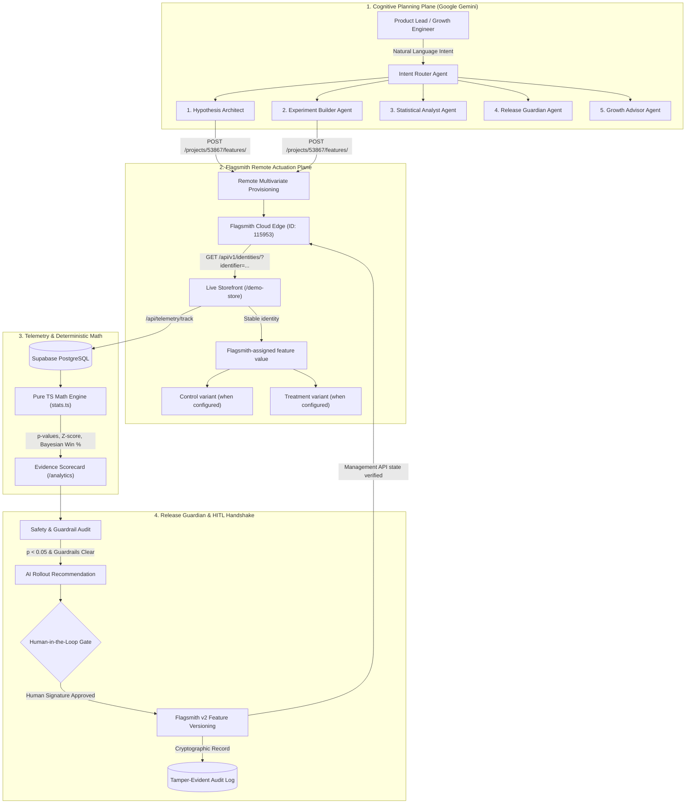

# PulsePilot AI 🚀
### Autonomous AI Experimentation & Product Growth Platform Powered by Flagsmith
**WeMakeDevs × Flagsmith Toggle Wars — Track 02: AI Agents and Feature Flags ($1,000 Cash Prize)**

---

[](https://flagsmith.com)
[](https://ai.google.dev)
[](https://nextjs.org)
[](https://www.typescriptlang.org)
[](https://opensource.org/licenses/MIT)

**Live Application:** [https://pulse-pilot-two.vercel.app/](https://pulse-pilot-two.vercel.app/)
**GitHub Repository:** [https://github.com/Shubhamver45/PulsePilot](https://github.com/Shubhamver45/PulsePilot)
**Flagsmith Cloud Project:** Project ID `53867` • Feature `exp_checkout_layout_v2`

**Deployment and judging notes:** [Competition Readiness & Deployment Notes](docs/COMPETITION_READINESS.md) · [Live Flagsmith integration tests](tests/flagsmith-integration.test.ts)

---

## Deployment configuration

Hosted deployments require Supabase Auth, a persistent PostgreSQL connection, a Flagsmith environment key, a Flagsmith Organisation Management API token, and a Gemini API key for hosted AI-agent calls. The application distinguishes read-only Flagsmith Edge evaluation from Management API provisioning and mutations. It fails closed when authoritative Management state, persistent evidence, or operational guardrails cannot be verified.

### Live verification snapshot — 17 November 2026

- **Vercel Preview:** the last ready preview is on an earlier remediation commit. The latest branch passed isolated TypeScript, test and production-build checks, but Vercel rate-limited a subsequent preview build. The public landing page and health route on the earlier preview returned HTTP 200.
- **Flagsmith Edge:** connected; the environment returns two flags. Two distinct test identities evaluated for `exp_checkout_layout_v2` both currently receive `treatment`. This confirms live evaluation, **not** a valid control/treatment traffic split.
- **Flagsmith Management API:** not configured in Vercel because an Organisation API token is absent. Keyed multivariate provisioning and remote rollout therefore remain unavailable.
- **PostgreSQL:** the Supabase project is active, but Vercel has no configured `DATABASE_URL`/`DIRECT_URL` for the hosted app. Database-backed registration, scorecards, and persistent telemetry cannot be signed off end-to-end.
- **Gemini:** the hosted Gemini API credential is not configured, so hosted multi-agent generation has not been verified.

The Release Guardian blocks real rollout while these prerequisites or real statistical/guardrail evidence are missing. Do not interpret a connected Edge API or an offline mock test as proof that the hosted A/B experiment is fully configured.

See [Competition Readiness & Deployment Notes](docs/COMPETITION_READINESS.md) for the complete environment-variable contract, canonical provisioning path, telemetry attribution rules, synthetic traffic isolation, and safe Preview setup.

---

## 🌟 Problem & Solution

### The Problem
Traditional product experimentation is manual, sluggish, and risky:
1. **Slow Experiment Cycles:** Formulating hypotheses, writing code, and wiring feature flags takes cross-functional teams 2–4 weeks per test.
2. **LLM Hallucination Risk:** Generative AI tools often guess or hallucinate statistical metrics, p-values, and conversion confidence.
3. **Unsafe Autonomous Mutations:** Granting AI agents direct write-access to production feature flags without human governance leads to catastrophic outages or revenue losses.

### The Solution: PulsePilot AI
PulsePilot AI turns natural language product intent into verified, live A/B and multivariate experiments actuated through **Flagsmith Cloud**:
1. **Prompt-to-Experiment Planning:** Gemini 2.5 Flash generates structured plans when `GEMINI_API_KEY` is configured. The application identifies its deterministic offline planner when Gemini is unavailable; it never labels that fallback as a Gemini response.
2. **Flagsmith Remote Actuation Plane:** The canonical provisioning and release code creates keyed multivariate options and verifies the environment's actual allocations through the Management API. Live writes require a scoped Organisation API token; missing credentials fail closed.
3. **Zero-Hallucination Math Engine:** Strict mathematical integrity: an LLM NEVER computes statistics. Two-tailed Z-tests, p-values ($p < 0.05$), relative uplift, and Bayesian win probabilities are calculated by a pure TypeScript engine (`stats.ts`).
4. **Strict Human-in-the-Loop (HITL) Governance:** The Release Guardian recommends winners, but production mutations require authenticated human approval before Flagsmith API execution.

---

## 🏗️ System Architecture



---

## 🤖 The Five-Agent Design

PulsePilot structures autonomous experimentation across five specialized AI agents powered by Gemini 2.5 Flash:

| Agent | Role | Responsibilities | Output Schema |
| :--- | :--- | :--- | :--- |
| **1. Hypothesis Architect** | Strategy Agent | Synthesizes business objectives into testable hypotheses, control/treatment definitions, and metric selections. | `ExperimentStrategySchema` |
| **2. Experiment Builder** | Builder Agent | Translates hypotheses into Flagsmith multivariate payloads, JSON states, and frontend integration code snippets. | `BuilderOutputSchema` |
| **3. Statistical Analyst** | Analytics Agent | Ingests deterministic math metrics, explains why variants are winning, and checks sample ratio mismatches (SRM). | `AnalyticsReportSchema` |
| **4. Release Guardian** | Safety & Rollout | Evaluates 5-point release checklists, monitors guardrail thresholds, and proposes canary ramps or rollbacks. | `ReleaseGuardianSchema` |
| **5. Growth Advisor** | Strategic Advisor | Discovers commercial takeaways, catalogs learned user patterns, and suggests high-ROI follow-up tests. | `GrowthTakeawaySchema` |

---

## 🚩 Real Flagsmith Integration Details

PulsePilot interacts directly with live Flagsmith Cloud resources on **Project ID `53867`**:

1. **Multivariate Remote Feature Provisioning:**
   - Endpoint: `POST https://api.flagsmith.com/api/v1/projects/53867/features/`
   - Authorization: `Api-Key ${FLAGSMITH_ORG_API_TOKEN}`
   - Type: `MULTIVARIATE` with keyed string values and percentage allocations.
2. **Flagsmith v2 Feature Versioning Lifecycle:**
   - Environments with versioning enabled reject direct `PATCH /featurestates/`.
   - PulsePilot implements the official v2 versioning lifecycle:
     1. `POST /environments/{envId}/features/{featureId}/versions/` $\to$ Creates version draft.
     2. `PUT /environments/{envId}/features/{featureId}/versions/{uuid}/featurestates/{draftId}/` $\to$ Mutates traffic weights.
     3. `POST /environments/{envId}/features/{featureId}/versions/{uuid}/publish/` $\to$ Publishes to the edge.
3. **Authoritative Read-After-Write Verification:**
   - A published mutation is followed by a Management API read of the environment feature state.
   - The application compares the requested enabled/default-value/variant allocations with the returned state and reports success only when they match.
   - A read-only Edge evaluation is not treated as proof that a Management API mutation succeeded.
4. **Architectural Evaluation: Direct REST API vs. CLI & MCP Subprocesses:**
   - *Flagsmith CLI & MCP:* Evaluated thoroughly. Flagsmith CLI is optimal for local shell scripting, while `@flagsmith/mcp` is designed for desktop IDE extensions (Cursor/Claude Desktop).
   - *Decision:* In a cloud serverless runtime (Next.js/Vercel), spawning shell CLI/MCP subprocesses introduces container cold-starts, lacks typed return schemas, and adds container image bloat. Direct HTTPS REST API integration with v2 Feature Versioning provides deterministic, type-safe execution with zero container overhead.

---

## 🎬 Planned 3-Minute Demo Sequence (Track 02 — after live prerequisites are configured)

| Timestamp | Screen | Narrative & Demonstration |
| :--- | :--- | :--- |
| **0:00 – 0:35** | [`/studio`](https://pulse-pilot-two.vercel.app/studio) | **Act 1: Prompt-to-Experiment Planning.** Enter a checkout hypothesis, inspect the generated plan, source badge (Gemini or deterministic fallback), control/treatment variants, traffic allocation, metrics and required events. Remote provisioning is demonstrated only after the Management API credential is configured. |
| **0:35 – 1:20** | [`/demo-store`](https://pulse-pilot-two.vercel.app/demo-store?flag=exp_checkout_layout_v2) | **Act 2: Live Flagsmith Multivariate Bucketing.** Demonstrate two distinct identities receiving different values only after the remote feature has verified keyed Control and Treatment options with a non-zero allocation split. The current environment has not passed this check yet. |
| **1:20 – 1:55** | [`/analytics`](https://pulse-pilot-two.vercel.app/analytics) | **Act 3: Telemetry & Anti-Hallucination Analytics.** Record a persisted exposure and conversion, then show the actual sample size, conversion rates, deterministic Z-test, Bayesian probability and SRM result. Do not use seeded or synthetic figures as customer evidence. |
| **1:55 – 2:40** | [`/release-center`](https://pulse-pilot-two.vercel.app/release-center) | **Act 4: Human-in-the-Loop Rollout.** Show the live evidence gate. Proceed only if the server confirms real sample size, significance, Bayesian probability, SRM and configured guardrails. The server rejects simulated readiness and blocks mutations until a Management API token is available. |
| **2:40 – 3:00** | [`/activity`](https://pulse-pilot-two.vercel.app/activity) | **Act 5: Tamper-Evident Governance Audit Log.** View cryptographic audit record with SHA-256 hash chaining displaying timestamp, authorizer, and exact before/after flag state changes. |

---

## 🛠️ Technology Stack

| Component | Technology | Version / Provider |
| :--- | :--- | :--- |
| **Frontend Framework** | Next.js 14 (App Router) | React 18, Strict TypeScript, Tailwind CSS |
| **UI Design System** | Executive Light Theme | Custom Zinc/Slate + Soft Lavender (`#7C3AED`), Lucide Icons |
| **Data Visualizations** | Recharts | Smooth trajectory charts, confidence intervals, tooltips |
| **Feature Flags Engine** | Flagsmith Cloud | Edge identity evaluation, keyed multivariate options, Management API versioning and read-back verification |
| **AI Agent Model** | Google Gemini (when configured) | `gemini-2.5-flash`, Zod structured output, deterministic offline fallback with provenance |
| **Database & ORM** | Supabase Managed PostgreSQL | Prisma ORM 6 (12 relational models, audit logs) |
| **Math Engine** | Pure TypeScript (`stats.ts`) | Abramowitz-Stegun Normal CDF, Two-tailed Z-tests, Beta-Binomial Bayes |

---

## 🧪 Testing & Verification Evidence

All functional, security, and Flagsmith integration test suites run automatically:

```bash
# 1. TypeScript Strict Type-Check (0 Errors)
npx tsc --noEmit

# 2. Prompt-plan validation and remote allocation proof tests (12/12 Passed)
npm run test:experiment-plan

# 3. Flagsmith integration and offline lifecycle suite (21/21 Passed)
npm run test:flagsmith

# 4. Comprehensive QA, Math Integrity & Security Audit (36/36 Passed)
npm run test:audit

# 5. Standard statistical, analytics, telemetry and audit suites
npm test

# 6. Production Next.js Build (44/44 Pages Compiled)
npm run build
```

### Test Suite Summary:
- **12 / 12 prompt-plan and allocation verification tests passed:** Invalid plans, duplicate keys/values, missing guardrail instrumentation, mismatched default values, allocation drift and unconfigured remote options are rejected.
- **21 / 21 Flagsmith integration checks passed in the isolated test environment:** Credential validation, deterministic identity behavior, offline canary/winner/rollback/kill-switch lifecycle, production-vs-mock guards, segment/trait checks, and secret-leakage checks. The suite explicitly skips live Management API calls when the Organisation token is unavailable; it is not evidence of a live remote rollout.
- **36 / 36 Comprehensive Audit Tests Passed:** High-precision Normal CDF approximation, two-tailed p-value calculation, Bayesian win probability, SRM Chi-Square detection, prompt injection neutralization, and zero-secret-leakage verification.

---

## 💻 Local Installation & Setup

```bash
# 1. Clone repository
git clone https://github.com/Shubhamver45/PulsePilot.git
cd PulsePilot

# 2. Install dependencies
npm install

# 3. Configure environment variables (.env)
cp .env.example .env
# Fill in GEMINI_API_KEY, FLAGSMITH_ENVIRONMENT_KEY, FLAGSMITH_SERVER_SIDE_API_KEY,
# FLAGSMITH_ORG_API_TOKEN, FLAGSMITH_PROJECT_ID, and DATABASE_URL.

# 4. Initialize Prisma client & database
npx prisma generate
npx prisma db push

# 5. Start development server
npm run dev
# Open http://localhost:3000 in your browser
```

---

## 👥 Hackathon Team & Acknowledgments

- **Lead Engineer & Architect:** Shubham Verma ([@Shubhamver45](https://github.com/Shubhamver45))
- **Built for:** WeMakeDevs × Flagsmith Toggle Wars Hackathon
- **Track:** Track 02 — AI Agents & Feature Flags
- **Target Cash Prize:** $1,000

---

## 📄 License
This project is open-source under the [MIT License](LICENSE).
