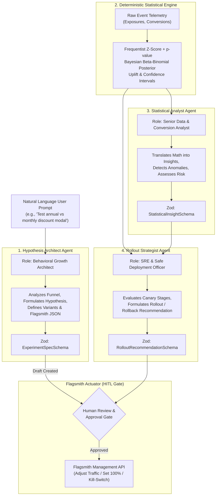

# AI Agent Architecture & Design
## PulsePilot AI — Autonomous Experimentation & Growth Platform
**Hackathon Track:** Flagsmith Toggle Wars — Track 02: AI Agents & Feature Flags  
**Author:** Principal Architect & Technical Lead  
**Version:** 1.0.0  

---

## 1. Agent Design Philosophy

In PulsePilot AI, AI Agents are **cognitive planners and synthesizers**, while **Flagsmith is the deterministic actuator** and **TypeScript is the deterministic mathematician**. 

To build an enterprise-trustworthy platform, we enforce three cardinal rules:
1. **Never allow AI to compute statistics:** Large Language Models are prone to arithmetic errors, floating-point drift, and probabilistic hallucination. All Z-tests, sample variances, Bayesian posteriors, and uplift percentages are computed by deterministic TypeScript math modules before being fed into an agent.
2. **Never allow unapproved autonomous production mutations:** The agent formulates experiments, prepares Flagsmith payloads, and recommends rollouts, but **Human-in-the-Loop (HITL)** approval is mandatory before modifying live traffic.
3. **Structured Outputs with Zod Enforcement:** All agent interactions utilize Gemini's structured JSON output mode, strictly validated against runtime Zod schemas. Any schema mismatch triggers immediate retry or safe degradation.

---

## 2. Multi-Agent Ecosystem



---

## 3. Detailed Agent Specifications

### 3.1 Hypothesis Architect Agent

- **Mission:** Convert high-level product intent into a rigorously structured, multi-variant experiment ready for Flagsmith deployment.
- **Input Context:** User natural language prompt, project domain (e.g. B2B SaaS, E-commerce), existing project metrics, target conversion funnel.
- **Zod Schema Definition:**

```typescript
import { z } from "zod";

export const VariantSpecSchema = z.object({
  key: z.string().regex(/^[a-z0-9_]+$/, "Variant key must be lowercase alphanumeric with underscores"),
  name: z.string().min(2).max(64),
  description: z.string().max(255),
  isControl: z.boolean(),
  trafficAllocation: z.number().int().min(0).max(100),
  featureValue: z.record(z.any()).describe("JSON payload delivered via Flagsmith feature state")
});

export const ExperimentSpecSchema = z.object({
  title: z.string().min(5).max(100),
  hypothesis: z.string().min(20).max(500),
  problemStatement: z.string().max(500),
  flagsmithFeatureName: z.string().regex(/^exp_[a-z0-9_]+$/, "Flagsmith feature must start with exp_"),
  targetAudience: z.string().max(200),
  primaryMetric: z.string().min(2).max(50),
  guardrailMetrics: z.array(z.string()).default([]),
  estimatedSampleSize: z.number().int().positive().default(1000),
  variants: z.array(VariantSpecSchema).min(2).max(5).refine(
    (variants) => {
      const sum = variants.reduce((acc, v) => acc + v.trafficAllocation, 0);
      return sum === 100;
    },
    { message: "Traffic allocation across all variants must sum to exactly 100%" }
  )
});

export type ExperimentSpec = z.infer<typeof ExperimentSpecSchema>;
```

---

### 3.2 Statistical Analyst Agent

- **Mission:** Ingest pure mathematical outputs and generate executive-grade narrative analyses, detecting subtle biases, sample ratio mismatches (SRM), and behavioral observations.
- **Input Context:** 
  - Variant exposure and conversion totals.
  - Calculated conversion rates, relative uplift ($\Delta\%$).
  - Two-tailed p-value and 95% confidence intervals.
  - Bayesian probability of beating control.
  - Target sample size progress percentage.
- **Zod Schema Definition:**

```typescript
export const StatisticalInsightSchema = z.object({
  statusSummary: z.string().max(300),
  currentLeaderVariantKey: z.string().nullable(),
  statisticalSignificanceReached: z.boolean(),
  confidenceLevel: z.number().min(0).max(1), // e.g. 0.975
  sampleSizeAdequacy: z.enum(["INSUFFICIENT", "APPROACHING", "SUFFICIENT"]),
  keyObservations: z.array(z.string()).min(1).max(5),
  riskFactors: z.array(z.string()),
  sampleRatioMismatchDetected: z.boolean()
});

export type StatisticalInsight = z.infer<typeof StatisticalInsightSchema>;
```

---

### 3.3 Rollout Strategist Agent

- **Mission:** Synthesize statistical certainty, business risk, and guardrail health to issue clear deployment guidance.
- **Input Context:** Statistical insights, guardrail metric deltas, current Flagsmith flag state, experiment duration.
- **Decision Matrix:**
  - If $p < 0.05$, sample size target met, and Bayesian win prob $> 95\% \implies$ **Recommend 100% Rollout of Winner**.
  - If primary metric is positive but sample size $< 80\% \implies$ **Recommend Continue Running**.
  - If guardrail metric drops by $> 5\%$ (with $p < 0.05$) $\implies$ **Recommend Emergency Rollback (Kill-Switch)**.
  - If high variance or inconclusive results $\implies$ **Recommend Iteration / Stopping**.
- **Zod Schema Definition:**

```typescript
export const RolloutRecommendationSchema = z.object({
  action: z.enum([
    "MAINTAIN_CURRENT",
    "PROGRESSIVE_RAMP_UP",
    "ROLLOUT_WINNER",
    "ROLLBACK_ABORT",
    "EMERGENCY_KILL_SWITCH"
  ]),
  targetVariantKey: z.string().nullable(),
  recommendedTrafficPercent: z.number().int().min(0).max(100),
  urgency: z.enum(["LOW", "MEDIUM", "HIGH", "CRITICAL"]),
  executiveRationale: z.string().min(20).max(500),
  flagsmithActionPayload: z.object({
    featureName: z.string(),
    actionType: z.string(),
    newMultivariateSplits: z.record(z.number()).optional(),
    enabledState: z.boolean()
  })
});

export type RolloutRecommendation = z.infer<typeof RolloutRecommendationSchema>;
```

---

## 4. Google Gemini API Integration Pattern

We utilize the `@google/genai` or standard REST SDK with system instruction injection and JSON schema validation:

```typescript
// Architectural Pattern for Agent Invocations
import { GoogleGenAI, Type } from "@google/genai";

const ai = new GoogleGenAI({ apiKey: process.env.GEMINI_API_KEY });

export async function invokeHypothesisArchitect(prompt: string, context: any) {
  const response = await ai.models.generateContent({
    model: "gemini-2.5-flash",
    contents: [
      {
        role: "user",
        parts: [{ text: `User Growth Intent: ${prompt}\nContext: ${JSON.stringify(context)}` }]
      }
    ],
    config: {
      systemInstruction: `You are the Principal Experimentation Architect for PulsePilot AI.
Formulate a rigorous A/B or multivariate experiment following statistical growth methodologies.
Always output valid JSON conforming strictly to the requested schema.`,
      responseMimeType: "application/json"
    }
  });

  const rawJson = JSON.parse(response.text ?? "{}");
  return ExperimentSpecSchema.parse(rawJson);
}
```

---

## 5. Safeguard & Audit Protocols

1. **Deterministic Input Injection:** Agent prompts do not have direct DB access. Strict typed DTOs feed context.
2. **Execution Audit:** Every prompt, raw response, parsed structured output, and token count is persisted to the `agent_runs` table.
3. **Execution Failure Recovery:** If the model returns invalid JSON, a fallback retry with error diagnostics is performed once; if it fails again, a clean error response is returned to the user without crashing the application.

