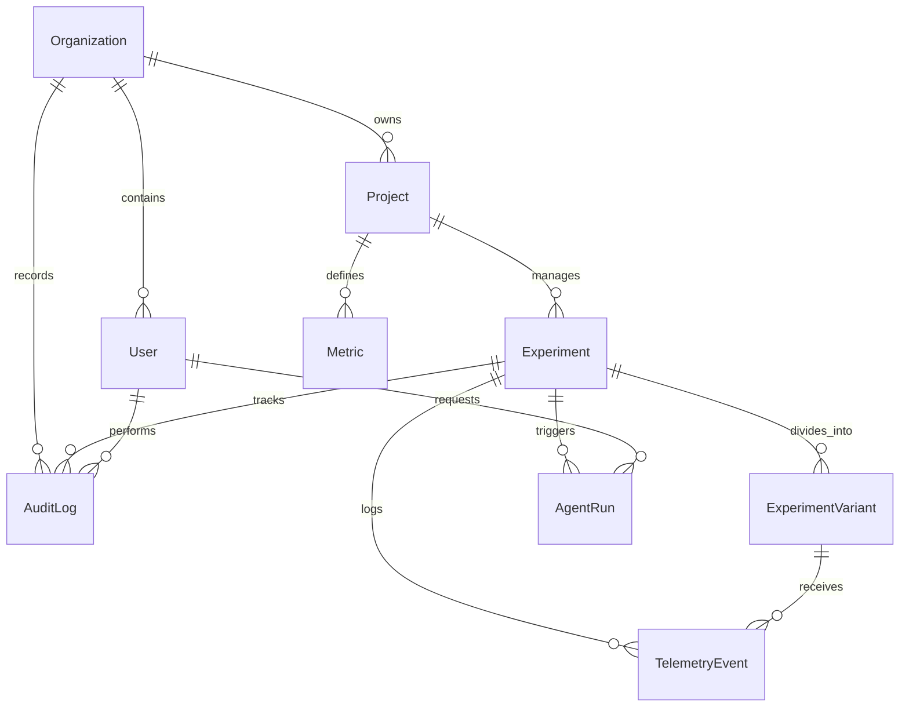

# Database Schema Specification
## PulsePilot AI — Autonomous Experimentation & Growth Platform
**Hackathon Track:** Flagsmith Toggle Wars — Track 02: AI Agents & Feature Flags  
**Author:** Principal Architect & Technical Lead  
**Database:** PostgreSQL (via Supabase)  
**ORM:** Prisma ORM  
**Version:** 1.0.0  

---

## 1. Entity-Relationship Overview



---

## 2. Complete Prisma Schema Definition

```prisma
datasource db {
  provider = "postgresql"
  url      = env("DATABASE_URL")
  directUrl = env("DIRECT_URL")
}

generator client {
  provider = "prisma-client-js"
}

enum UserRole {
  ADMIN
  EDITOR
  VIEWER
}

enum ExperimentStatus {
  DRAFT
  PENDING_APPROVAL
  ACTIVE
  PAUSED
  CONCLUDED_ROLLED_OUT
  CONCLUDED_ROLLED_BACK
}

enum EventType {
  EXPOSURE
  CONVERSION
}

enum MetricType {
  CONVERSION_RATE
  CLICK_THROUGH
  REVENUE
  RETENTION
  CUSTOM
}

enum AgentType {
  HYPOTHESIS_ARCHITECT
  STATISTICAL_ANALYST
  ROLLOUT_STRATEGIST
}

enum AuditAction {
  ORGANIZATION_CREATED
  PROJECT_CREATED
  EXPERIMENT_FORMULATED
  EXPERIMENT_APPROVED
  EXPERIMENT_DEPLOYED_FLAGSMITH
  FLAG_MODIFIED
  TRAFFIC_SPLIT_UPDATED
  ROLLOUT_RECOMMENDED
  ROLLOUT_APPROVED_EXECUTED
  ROLLBACK_EXECUTED
  EMERGENCY_KILL_SWITCH_TRIGGERED
}

// -------------------------------------------------------------
// Core Accounts & Workspaces
// -------------------------------------------------------------

model Organization {
  id          String      @id @default(cuid())
  name        String
  slug        String      @unique
  createdAt   DateTime    @default(now())
  updatedAt   DateTime    @updatedAt

  users       User[]
  projects    Project[]
  auditLogs   AuditLog[]

  @@map("organizations")
}

model User {
  id             String        @id // Corresponds to Supabase Auth UID
  email          String        @unique
  fullName       String?
  avatarUrl      String?
  role           UserRole      @default(EDITOR)
  organizationId String
  organization   Organization  @relation(fields: [organizationId], references: [id], onDelete: Cascade)
  createdAt      DateTime      @default(now())
  updatedAt      DateTime      @updatedAt

  auditLogs      AuditLog[]
  agentRuns      AgentRun[]

  @@index([organizationId])
  @@map("users")
}

model Project {
  id                       String        @id @default(cuid())
  name                     String
  description              String?
  organizationId           String
  organization             Organization  @relation(fields: [organizationId], references: [id], onDelete: Cascade)
  
  // Flagsmith Configuration per Project
  flagsmithProjectId       String?       // Flagsmith internal project ID
  flagsmithEnvironmentKey  String?       // Flagsmith Client-Side Environment Key
  flagsmithServerKey       String?       // Server-side SDK key (encrypted or reference)

  createdAt                DateTime      @default(now())
  updatedAt                DateTime      @updatedAt

  experiments              Experiment[]
  metrics                  Metric[]

  @@index([organizationId])
  @@map("projects")
}

// -------------------------------------------------------------
// Experimentation & Flagsmith Actuation
// -------------------------------------------------------------

model Experiment {
  id                   String            @id @default(cuid())
  projectId            String
  project              Project           @relation(fields: [projectId], references: [id], onDelete: Cascade)

  title                String
  hypothesis           String            @db.Text
  description          String?           @db.Text
  targetAudience       String?           // Description of segment / targeting rule
  
  // Flagsmith Flag Linkage
  flagsmithFeatureId   Int?              // Numerical ID in Flagsmith
  flagsmithFeatureName String            @unique // e.g. "exp_checkout_social_proof"
  
  status               ExperimentStatus  @default(DRAFT)
  primaryMetric        String            // Key of primary conversion metric
  guardrailMetrics     String[]          @default([])
  sampleSizeTarget     Int               @default(1000)
  
  // Resolution Metadata
  winningVariantId     String?
  rolloutRationale     String?           @db.Text
  concludedAt          DateTime?

  createdAt            DateTime          @default(now())
  updatedAt            DateTime          @updatedAt

  variants             ExperimentVariant[]
  telemetryEvents      TelemetryEvent[]
  agentRuns            AgentRun[]
  auditLogs            AuditLog[]

  @@index([projectId, status])
  @@index([flagsmithFeatureName])
  @@map("experiments")
}

model ExperimentVariant {
  id                String            @id @default(cuid())
  experimentId      String
  experiment        Experiment        @relation(fields: [experimentId], references: [id], onDelete: Cascade)

  key               String            // e.g., "control", "variant_social_proof"
  name              String            // e.g., "Social Proof Testimonial"
  description       String?           @db.Text
  isControl         Boolean           @default(false)
  trafficAllocation Int               @default(50) // Percentage (0-100)
  
  // Flagsmith Feature Value payload
  featureValue      Json              // Structured JSON with colors, copy, configs

  createdAt         DateTime          @default(now())
  updatedAt         DateTime          @updatedAt

  telemetryEvents   TelemetryEvent[]

  @@unique([experimentId, key])
  @@index([experimentId])
  @@map("experiment_variants")
}

model Metric {
  id          String      @id @default(cuid())
  projectId   String
  project     Project     @relation(fields: [projectId], references: [id], onDelete: Cascade)

  name        String
  key         String      // e.g. "signup_completed", "checkout_clicked"
  description String?
  type        MetricType  @default(CONVERSION_RATE)

  createdAt   DateTime    @default(now())
  updatedAt   DateTime    @updatedAt

  @@unique([projectId, key])
  @@map("metrics")
}

// -------------------------------------------------------------
// High-Throughput Telemetry Ingestion
// -------------------------------------------------------------

model TelemetryEvent {
  id             String             @id @default(cuid())
  experimentId   String
  experiment     Experiment         @relation(fields: [experimentId], references: [id], onDelete: Cascade)

  variantId      String
  variant        ExperimentVariant  @relation(fields: [variantId], references: [id], onDelete: Cascade)

  distinctUserId String             // Anonymized user/session key (Flagsmith Identity)
  eventType      EventType          // EXPOSURE or CONVERSION
  metricKey      String?            // If CONVERSION, which metric
  properties     Json?              // Contextual metadata (browser, locale, plan)
  timestamp      DateTime           @default(now())

  @@index([experimentId, variantId, eventType])
  @@index([experimentId, timestamp])
  @@index([distinctUserId])
  @@map("telemetry_events")
}

// -------------------------------------------------------------
// AI Agent Tracking & Cryptographic Audit Trails
// -------------------------------------------------------------

model AgentRun {
  id               String      @id @default(cuid())
  experimentId     String?
  experiment       Experiment? @relation(fields: [experimentId], references: [id], onDelete: SetNull)

  userId           String?
  user             User?       @relation(fields: [userId], references: [id], onDelete: SetNull)

  agentType        AgentType
  prompt           String      @db.Text
  rawResponse      String?     @db.Text
  structuredOutput Json
  tokensUsed       Int?
  modelName        String      @default("gemini-1.5-pro")

  createdAt        DateTime    @default(now())

  @@index([experimentId])
  @@index([agentType])
  @@map("agent_runs")
}

model AuditLog {
  id             String        @id @default(cuid())
  organizationId String
  organization   Organization  @relation(fields: [organizationId], references: [id], onDelete: Cascade)

  userId         String?
  user           User?         @relation(fields: [userId], references: [id], onDelete: SetNull)

  experimentId   String?
  experiment     Experiment?   @relation(fields: [experimentId], references: [id], onDelete: SetNull)

  action         AuditAction
  entityType     String        // e.g. "EXPERIMENT", "FLAGSMITH_FLAG"
  entityId       String
  
  previousState  Json?
  newState       Json?
  metadata       Json?         // IP address, user agent, rationale

  createdAt      DateTime      @default(now())

  @@index([organizationId, createdAt])
  @@index([experimentId])
  @@map("audit_logs")
}
```

---

## 3. Query Optimization & Real-Time Aggregation

Because PulsePilot AI calculates live uplift, confidence intervals, and Bayesian distributions directly from raw or indexed event logs, specific compound indexes are established:

1. `@@index([experimentId, variantId, eventType])`: Allows instant $O(1)$ index-range scans to count total exposures ($N$) and conversions ($C$) grouped by variant.
2. `@@index([experimentId, timestamp])`: Facilitates dynamic time-series charts (hourly/daily cumulative conversion trend lines).
3. `@@index([distinctUserId])`: Ensures unique identification and prevents duplicate conversion skewing for single-conversion experiments.

