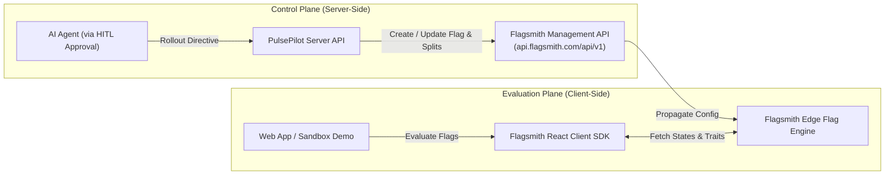

# Flagsmith Integration Specification
## PulsePilot AI — Autonomous Experimentation & Growth Platform
**Hackathon Track:** Flagsmith Toggle Wars — Track 02: AI Agents & Feature Flags  
**Author:** Principal Architect & Technical Lead  
**Version:** 1.0.0  

---

## 1. Dual-Tier Flagsmith Architecture

PulsePilot AI utilizes Flagsmith in two distinct execution tiers:
1. **Control & Actuation Plane (Server-Side Management API):** Used by our Next.js backend and AI agents to dynamically create, configure, update, re-weight, and toggle feature flags.
2. **Data & Evaluation Plane (Client-Side Flagsmith SDK):** Used by consumer-facing applications and our embedded Sandbox to evaluate feature flags in real-time based on user identity and traits.



---

## 2. Concept Mapping: PulsePilot vs. Flagsmith

| PulsePilot Concept | Flagsmith Counterpart | Technical Implementation |
|---|---|---|
| **Project** | Flagsmith Project | Identified by `FLAGSMITH_PROJECT_ID` |
| **Environment** | Flagsmith Environment | Development, Staging, Production (identified by Environment API Keys) |
| **Experiment** | Multivariate Feature Flag | Key format: `exp_<domain>_<descriptor>` (e.g., `exp_pricing_discount_v1`) |
| **Experiment Variant** | Multivariate Feature Option | Each variant has a percentage split (0–100%) and a stringified JSON value |
| **Control** | Feature Default Value | The base value returned when no multivariate option is selected or as the 0-variation |
| **End User / Visitor** | Flagsmith Identity | Distinct user key passed to `flagsmith.identify(userId)` with user traits |
| **Target Audience** | Flagsmith Segment | Evaluates rules such as `country == "US"` or `plan == "enterprise"` |
| **Emergency Rollback** | Flag State Disabled (`enabled: false`) | Immediate kill switch evaluated in $< 50$ ms |

---

## 3. Server-Side Management API Client (`flagsmith-admin.ts`)

PulsePilot communicates with Flagsmith's REST API using secure server-side tokens (`FLAGSMITH_MANAGEMENT_KEY` or `FLAGSMITH_SERVER_KEY`).

### 3.1 Provisioning a Multivariate Feature Flag

```typescript
// src/lib/flagsmith/flagsmith-admin.ts
export interface CreateMultivariateFlagParams {
  projectId: number;
  environmentApiKey: string;
  name: string; // e.g. "exp_checkout_cta"
  description: string;
  initialValue: string; // Control JSON payload
  variants: {
    key: string;
    trafficAllocation: number; // e.g. 50
    value: string; // JSON payload
  }[];
}

export async function createFlagsmithExperimentFlag(params: CreateMultivariateFlagParams) {
  const managementKey = process.env.FLAGSMITH_MANAGEMENT_KEY;
  if (!managementKey) {
    throw new Error("FLAGSMITH_MANAGEMENT_KEY is not configured on the server");
  }

  // 1. Create Feature in Project
  const createFeatureRes = await fetch(
    `https://api.flagsmith.com/api/v1/projects/${params.projectId}/features/`,
    {
      method: "POST",
      headers: {
        "Content-Type": "application/json",
        "Authorization": `Token ${managementKey}`
      },
      body: JSON.stringify({
        name: params.name,
        type: "MULTIVARIATE",
        default_enabled: true,
        initial_value: params.initialValue,
        description: params.description,
        multivariate_options: params.variants.map((v) => ({
          type: "unicode",
          string_value: v.value,
          default_percentage_allocation: v.trafficAllocation
        }))
      })
    }
  );

  if (!createFeatureRes.ok) {
    const errorText = await createFeatureRes.text();
    throw new Error(`Flagsmith Flag Creation Failed: ${createFeatureRes.status} - ${errorText}`);
  }

  return await createFeatureRes.json();
}
```

### 3.2 Executing a 100% Winner Rollout

When the human approver accepts the AI's rollout recommendation:

```typescript
export async function rolloutFlagsmithWinner(
  featureId: number,
  environmentApiKey: string,
  winningVariantValue: string
) {
  const managementKey = process.env.FLAGSMITH_MANAGEMENT_KEY;

  // Update feature state in environment to 100% of the winning variant
  const response = await fetch(
    `https://api.flagsmith.com/api/v1/environments/${environmentApiKey}/feature-states/`,
    {
      method: "POST",
      headers: {
        "Content-Type": "application/json",
        "Authorization": `Token ${managementKey}`
      },
      body: JSON.stringify({
        feature: featureId,
        enabled: true,
        feature_state_value: winningVariantValue,
        multivariate_feature_state_values: [] // Clear split allocations; 100% goes to base value
      })
    }
  );

  return await response.json();
}
```

### 3.3 Emergency Kill-Switch (Zero-Downtime Rollback)

```typescript
export async function triggerEmergencyKillSwitch(
  featureStateId: number,
  environmentApiKey: string
) {
  const managementKey = process.env.FLAGSMITH_MANAGEMENT_KEY;

  const response = await fetch(
    `https://api.flagsmith.com/api/v1/environments/${environmentApiKey}/feature-states/${featureStateId}/`,
    {
      method: "PATCH",
      headers: {
        "Content-Type": "application/json",
        "Authorization": `Token ${managementKey}`
      },
      body: JSON.stringify({
        enabled: false
      })
    }
  );

  return await response.json();
}
```

---

## 4. Client-Side Flagsmith React SDK Integration

In consumer interfaces and the PulsePilot interactive demo surface, flags are evaluated seamlessly using `flagsmith/react`.

### 4.1 Root Provider Setup

```tsx
// src/components/providers/FlagsmithProviderWrapper.tsx
"use client";

import flagsmith from "flagsmith";
import { FlagsmithProvider } from "flagsmith/react";
import React, { ReactNode } from "react";

export function FlagsmithProviderWrapper({ children }: { children: ReactNode }) {
  return (
    <FlagsmithProvider
      flagsmith={flagsmith}
      options={{
        environmentID: process.env.NEXT_PUBLIC_FLAGSMITH_ENVIRONMENT_ID || "demo-env-key",
        cacheFlags: true,
        enableAnalytics: true
      }}
    >
      {children}
    </FlagsmithProvider>
  );
}
```

### 4.2 Dynamic Flag Evaluation & Telemetry Triggering

```tsx
// src/components/demo/PricingExperimentSurface.tsx
"use client";

import { useFlags, useFlagsmith } from "flagsmith/react";
import { useEffect, useState } from "react";

export function PricingExperimentSurface({ userId }: { userId: string }) {
  const flags = useFlags(["exp_checkout_social_proof"]);
  const flagsmith = useFlagsmith();
  const [featureConfig, setFeatureConfig] = useState<any>(null);

  useEffect(() => {
    if (userId) {
      flagsmith.identify(userId);
    }
  }, [userId, flagsmith]);

  useEffect(() => {
    const rawValue = flags.exp_checkout_social_proof.value;
    try {
      setFeatureConfig(typeof rawValue === "string" ? JSON.parse(rawValue) : rawValue);
    } catch {
      setFeatureConfig({ ctaText: "Upgrade Now", badge: "Standard" });
    }

    // Record Exposure Telemetry
    if (flags.exp_checkout_social_proof.enabled) {
      fetch("/api/telemetry/track", {
        method: "POST",
        headers: { "Content-Type": "application/json" },
        body: JSON.stringify({
          flagsmithFeatureName: "exp_checkout_social_proof",
          distinctUserId: userId,
          eventType: "EXPOSURE",
          variantKey: flags.exp_checkout_social_proof.value ? "variant_a" : "control"
        })
      });
    }
  }, [flags.exp_checkout_social_proof, userId]);

  return (
    <div className="p-6 border rounded-xl bg-white shadow-sm">
      <span className="text-xs uppercase tracking-wider font-semibold text-violet-600">
        {featureConfig?.badge || "Default Offer"}
      </span>
      <h3 className="text-xl font-bold mt-2">
        {featureConfig?.headline || "Simple, Transparent Pricing"}
      </h3>
      <button
        onClick={() => {
          fetch("/api/telemetry/track", {
            method: "POST",
            headers: { "Content-Type": "application/json" },
            body: JSON.stringify({
              flagsmithFeatureName: "exp_checkout_social_proof",
              distinctUserId: userId,
              eventType: "CONVERSION",
              metricKey: "checkout_click"
            })
          });
        }}
        className="mt-4 px-4 py-2 bg-violet-600 text-white rounded-lg hover:bg-violet-700"
      >
        {featureConfig?.ctaText || "Get Started"}
      </button>
    </div>
  );
}
```

---

## 5. Resilient Mock & Fallback Mode

To enable developers and hackathon judges to test PulsePilot AI even before setting up a private Flagsmith Cloud project:
- A built-in **Flagsmith Mock Adapter** runs transparently when `FLAGSMITH_MANAGEMENT_KEY` or `NEXT_PUBLIC_FLAGSMITH_ENVIRONMENT_ID` are set to `mock` or omitted.
- The mock adapter simulates realistic HTTP responses, tracks multivariate states in memory/local database, and guarantees an instant, zero-friction developer experience out of the box.

