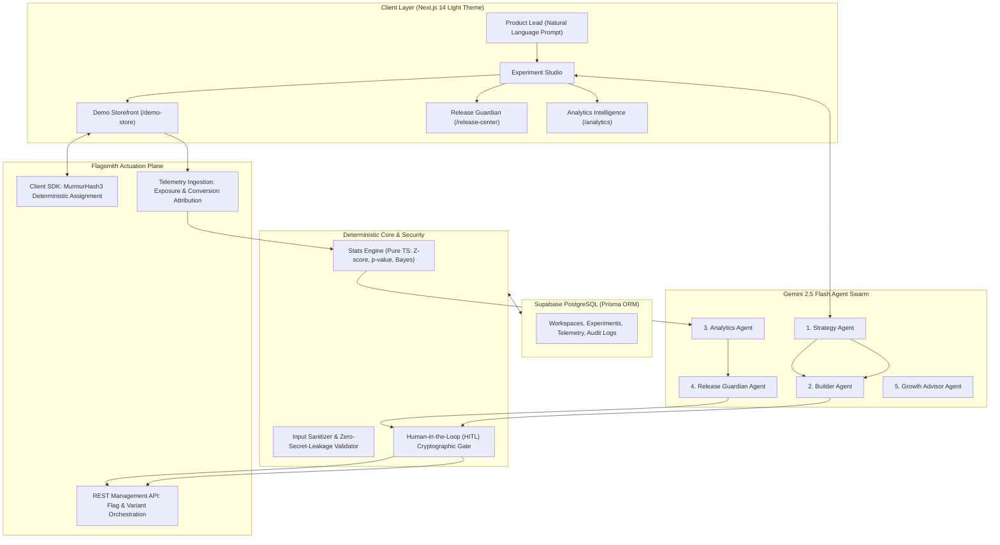

# PulsePilot AI — From Ideas to Winning Experiments
## Flagsmith Toggle Wars (Track 02: AI Agents & Feature Flags)
### Complete Hackathon Presentation Deck & 3-Minute Demo Video Script

---

# PART 1: THE 12-SLIDE PRESENTATION DECK

```
VISUAL THEME SPECIFICATION:
• Palette: Crisp White (#FFFFFF), Ultra-Soft Slate (#F8FAFC), Vibrant Violet Accent (#7C3AED), Soft Lavender (#EDE9FE), Deep Charcoal (#0F172A).
• Aesthetics: Minimalist, executive-grade light theme inspired by Linear, Stripe, and Vercel.
• Visuals: Component cards, high-contrast badges, structured data flows, and clean typography.
```

---

## Slide 1: Title & Product Introduction

### Visual Layout:
```
+---------------------------------------------------------------------------------------------------+
|  [⚡ Violet Glow Icon] PulsePilot AI                                         FLAGSMITH TOGGLE WARS |
|                                                                                                   |
|                                       PULSEPILOT AI                                               |
|                           From Ideas to Winning Experiments                                       |
|                                                                                                   |
|             "The Autonomous Experimentation & Product Growth Platform"                           |
|       Turning natural language hypotheses into production-actuated Flagsmith experiments          |
|                                                                                                   |
|  +---------------------------+  +---------------------------+  +-------------------------------+  |
|  |   5 Autonomous AI Agents  |  |   Deterministic Stats     |  |   Human-in-the-Loop Release   |  |
|  |   Gemini 2.5 Flash Swarm  |  |   Zero Math Hallucination |  |   Canary & Instant Rollback   |  |
|  +---------------------------+  +---------------------------+  +-------------------------------+  |
|                                                                                                   |
|  Track 02: AI Agents & Feature Flags                                     Team: PulsePilot Core    |
+---------------------------------------------------------------------------------------------------+
```

### Slide Content:
- **Title:** PulsePilot AI — From Ideas to Winning Experiments
- **Subtitle:** The Autonomous AI Experimentation & Feature Flag Orchestrator
- **The Core Promise:** Close the broken loop between product intuition, multivariate feature flags, and safe production rollouts.
- **Key Badges:** 
  - `Powered by Flagsmith Cloud`
  - `Google Gemini 2.5 Flash Multi-Agent Swarm`
  - `Pure TypeScript Mathematical Integrity`
  - `Strict Human-in-the-Loop Governance`

### Speaker Notes:
> *"Good morning, judges. Every product team wants to run high-velocity experiments. But between writing specifications, instrumenting feature flags, analyzing statistics, and managing rollouts, experimentation today is slow, risky, and fragmented. Meet PulsePilot AI: an autonomous experimentation co-pilot that turns high-level growth objectives into fully configured Flagsmith experiments, analyzes statistical data without LLM hallucination, and safely rolls out winning variants with automated canary guardrails. Let’s dive into how it works."*

---

## Slide 2: The Problem with Traditional Experimentation

### Visual Layout:
```
+---------------------------------------------------------------------------------------------------+
|  THE STATUS QUO IS BROKEN                                                                         |
|                                                                                                   |
|  [ 1. Formulation Bottleneck ]      [ 2. Integration Chasm ]         [ 3. Statistical Risk ]      |
|  +---------------------------+      +---------------------------+    +--------------------------+ |
|  | Hypotheses are trapped in |  --> | Developers spend hours    | -> | Teams misinterpret       | |
|  | PRDs and Jira tickets for |      | writing boilerplate flag  |    | noise as signal; LLMs    | |
|  | weeks before being coded. |      | configs and event schemas.|    | hallucinate p-values.    | |
|  +---------------------------+      +---------------------------+    +--------------------------+ |
|                                                                                                   |
|  [ 4. Rollout Paralysis ]                                                                         |
|  +----------------------------------------------------------------------------------------------+ |
|  | 82% of winning experiments stall before 100% rollout due to fear of breaking production.    | |
|  | Rollbacks are manual, slow, and lack cryptographic audit trails.                             | |
|  +----------------------------------------------------------------------------------------------+ |
+---------------------------------------------------------------------------------------------------+
```

### Slide Content:
- **The 4 Experimentation Chasms:**
  1. **The Formulation Bottleneck:** Ideas take weeks to transform from product thoughts into structured hypotheses and metric definitions.
  2. **The Integration Chasm:** Engineering friction setting up multivariate flag values, client evaluations, and event telemetry.
  3. **The Statistical Trap:** Teams declare premature "winners" on sample noise, or rely on LLMs that hallucinate arithmetic and p-values.
  4. **The Deployment Fear:** Even when an experiment wins, pushing to 100% production is terrifying without automated guardrails and safe rollbacks.

### Speaker Notes:
> *"The problem isn’t that teams lack ideas; it’s the massive execution friction. Today, turning an idea into a live test takes weeks of back-and-forth across Jira, codebases, and analytics dashboards. Worse, when experiments finish, teams either misinterpret the statistics or hesitate to roll out because they lack real-time guardrail monitoring. If conversion drops or payment gateways fail, rollbacks are slow and manual. Experimentation shouldn't be this risky."*

---

## Slide 3: Our Proposed Solution

### Visual Layout:
```
+---------------------------------------------------------------------------------------------------+
|  THE PULSEPILOT PARADIGM SHIFT                                                                    |
|                                                                                                   |
|      NATURAL LANGUAGE OBJECTIVE            AUTONOMOUS AGENT ORCHESTRATION       SAFE PRODUCTION   |
|                                                                                                   |
|   +------------------------------+         +----------------------------+      +----------------+ |
|   | "Optimize mobile checkout    |  ====>  | Strategy -> Builder ->     | ===> | Live Flagsmith | |
|   |  to reduce cart abandonment" |         | Analytics -> Guardian      |      | Canary Rollout | |
|   +------------------------------+         +----------------------------+      +----------------+ |
|                                                                                                   |
|   +---------------------------------------------------------------------------------------------+ |
|   |  KEY DIFFERENTIATORS:                                                                       | |
|   |  1. End-to-End Autonomous Lifecycle: Idea -> Flagsmith Flag -> Telemetry -> Rollout        | |
|   |  2. Mathematical Integrity: Statistics computed deterministically, never guessed by AI    | |
|   |  3. Zero Unapproved Mutations: Strict Human-in-the-Loop cryptographic approval gate         | |
|   +---------------------------------------------------------------------------------------------+ |
+---------------------------------------------------------------------------------------------------+
```

### Slide Content:
- **The Closed-Loop Experimentation Platform:**
  - **Conversational Formulation:** Enter an objective in plain English; AI formulates hypotheses, metrics, and Flagsmith feature configurations.
  - **Direct Flagsmith Actuation:** Automatically creates multivariate feature flags with clean JSON payloads.
  - **Zero-Hallucination Stats Engine:** TypeScript math engine computes factual Z-scores, p-values, and Bayesian win probabilities.
  - **Autonomous Release Guardian:** Manages canary rollout stages (5% $\to$ 25% $\to$ 100%) and instant kill-switches when guardrails spike.

### Speaker Notes:
> *"PulsePilot AI unifies the entire experimentation lifecycle into an autonomous, closed-loop platform. A product manager types a business goal in plain English. PulsePilot’s agent swarm formulates the experiment, generates the Flagsmith multivariate flag, validates the telemetry pipeline, computes rigorous statistics using deterministic math, and assists with a safe, gradual canary rollout. But most importantly: the AI advises, but a human always approves."*

---

## Slide 4: PulsePilot AI Architecture

### Visual Layout (Architecture Diagram):



### Slide Content:
- **Client Plane:** Next.js 14 App Router, Tailwind CSS, Recharts, Responsive light theme.
- **Agent Plane:** 5 specialized Gemini 2.5 Flash agents operating with strict Zod structured outputs.
- **Deterministic Math Engine:** Pure TypeScript engine executing normal CDF, two-tailed Z-tests, and Sample Ratio Mismatch (SRM) checks.
- **Flagsmith Actuation Plane:** Real-time multivariate flag evaluation, identity hash stability, and segment override actuators.
- **Persistence:** Supabase PostgreSQL with 12 relational Prisma models and immutable audit trails.

### Speaker Notes:
> *"Here is our architectural blueprint. Notice the clear separation of concerns: The UI communicates with our Gemini 2.5 Flash agent swarm. However, the agents never perform mathematical calculations themselves. Instead, our pure TypeScript analytics engine ingests raw Flagsmith events, calculates deterministic statistics, and feeds them to the agents as grounded facts. Furthermore, the Builder and Release Guardian agents can never touch Flagsmith production flags without passing through our Human-in-the-Loop cryptographic approval gate."*

---

## Slide 5: The Five AI Agents

### Visual Layout:
```
+---------------------------------------------------------------------------------------------------+
|  THE PULSEPILOT MULTI-AGENT SWARM                                                                 |
|                                                                                                   |
|  +--------------------+  +--------------------+  +--------------------+  +---------------------+  |
|  | 1. STRATEGY AGENT  |  |  2. BUILDER AGENT  |  | 3. ANALYTICS AGENT |  | 4. RELEASE GUARDIAN |  |
|  | Translates product |  | Generates clean    |  | Ingests pre-computed|  | Orchestrates canary |  |
|  | problems into      |  | Flagsmith JSON     |  | stats; identifies   |  | stages (5%->100%);  |  |
|  | hypotheses &       |  | payloads & checks  |  | anomalies & lift    |  | monitors error      |  |
|  | metric trees.      |  | telemetry events.  |  | without hallucinating| thresholds.         |  |
|  +--------------------+  +--------------------+  +--------------------+  +---------------------+  |
|                                                                                                   |
|                             +-----------------------------------+                                 |
|                             |      5. GROWTH ADVISOR AGENT      |                                 |
|                             | Extracts cross-test meta-learning |                                 |
|                             | and prioritizes iterative backlog |                                 |
|                             +-----------------------------------+                                 |
+---------------------------------------------------------------------------------------------------+
```

### Slide Content:
1. **Strategy Agent:** Identifies business drop-offs, generates testable hypotheses, and selects primary and guardrail metrics.
2. **Experiment Builder Agent:** Validates traffic splits, generates Flagsmith multivariate JSON payloads, and verifies event tracking readiness.
3. **Analytics Agent:** Explains statistical lift, confidence intervals, and uncertainty using Flagsmith results as the factual ground truth.
4. **Release Guardian Agent:** Evaluates release readiness across a 5-point matrix, plans staged canary rollouts, and detects guardrail spikes.
5. **Growth Advisor Agent:** Synthesizes institutional learnings across previous experiments and recommends highest-ROI subsequent tests.

### Speaker Notes:
> *"We designed five purpose-built agents rather than a single monolithic prompt. The Strategy Agent defines what to test. The Builder Agent formats the Flagsmith multivariate flag and checks telemetry readiness. The Analytics Agent interprets experimental lift without inventing numbers. The Release Guardian monitors safety thresholds and plans canary progressions. And finally, the Growth Advisor aggregates cross-experiment learnings so product teams build compounding knowledge over time."*

---

## Slide 6: How Flagsmith Powers Our Experimentation

### Visual Layout:
```
+---------------------------------------------------------------------------------------------------+
|  THE FLAGSMITH ENGINE AT THE CORE                                                                 |
|                                                                                                   |
|  +-------------------------------------+       +-----------------------------------------------+  |
|  | 1. Deterministic MurmurHash3        |       | 2. Multivariate Value Payload                 |  |
|  | Stable identity assignment ensures  |       | Structured JSON feature states allow rich UI  |  |
|  | visitors never experience flicker   |       | variations without frontend redeployment.     |  |
|  | or split-assignment bugs.           |       |                                               |  |
|  +-------------------------------------+       +-----------------------------------------------+  |
|                                                                                                   |
|  +-------------------------------------+       +-----------------------------------------------+  |
|  | 3. Edge-Cached Low-Latency Flags    |       | 4. Server-Side Management API                 |  |
|  | Fast flag evaluations at the client |       | Programmatic flag creation, traffic           |  |
|  | SDK level (< 25ms response time).   |       | re-allocations, and canary promotions.        |  |
|  +-------------------------------------+       +-----------------------------------------------+  |
+---------------------------------------------------------------------------------------------------+
```

### Slide Content:
- **Core Flagsmith Capabilities Used:**
  - **Multivariate Features:** Configured with weighted split allocations (e.g. 34% / 33% / 33%) delivering dynamic JSON configurations.
  - **Deterministic Identity Evaluation:** Flagsmith client SDK consistently maps unique user IDs (`distinctUserId`) to identical variations across sessions.
  - **Zero Flicker:** Fast client initialization preventing layout shifts.
  - **Remote Management API:** Programmatic actuation of segment overrides and rollout percentages from server route handlers.
  - **Event & Telemetry Ingestion:** Clean tracking of exposures and goal conversions.

### Speaker Notes:
> *"Flagsmith is the indispensable backbone of PulsePilot. First, Flagsmith’s multivariate feature states allow us to store structured JSON configuration payloads directly in the flag. Second, Flagsmith’s deterministic MurmurHash3 evaluation guarantees that an identity receives the exact same variation across visits with zero UI flicker. Third, Flagsmith’s REST Management API allows our server-side Release Guardian to programmatically actuate traffic re-allocations and canary promotions without requiring manual dashboard toggling."*

---

## Slide 7: Live Checkout Experiment Demonstration

### Visual Layout:
```
+---------------------------------------------------------------------------------------------------+
|  FLAGSMITH MULTIVARIATE EXPERIMENT: checkout_experience                                           |
|                                                                                                   |
|  [ CONTROL: 34% ]                  [ VARIANT A: 33% ]               [ VARIANT B: 33% ]            |
|  +-----------------------+         +-----------------------+        +-----------------------+     |
|  | 3-Step Wizard Flow    |         | Single-Page Layout    |        | 1-Click Express Flow  |     |
|  | Shipping -> Billing   |         | All fields on single  |        | Digital wallet &      |     |
|  | -> Confirmation       |         | responsive view.      |        | instant 1-tap buy.    |     |
|  +-----------------------+         +-----------------------+        +-----------------------+     |
|  Baseline Conversion: 10.0%        Expected Lift: +15.0%            Expected Lift: +24.1%         |
|                                                                                                   |
|  +----------------------------------------------------------------------------------------------+ |
|  |  STABLE IDENTITY LINKAGE:                                                                    | |
|  |  EXPOSURE Event (distinctUserId: 'usr_8492') ===> CONVERSION Event (distinctUserId: 'usr_8492')| |
|  |  Guarantees 100% accurate conversion attribution without false positives.                    | |
|  +----------------------------------------------------------------------------------------------+ |
+---------------------------------------------------------------------------------------------------+
```

### Slide Content:
- **Target Feature Flag:** `checkout_experience` in Flagsmith project `53867`.
- **The 3 Variants Tested in PulsePilot Shop (`/demo-store`):**
  - **Control (34%):** Traditional 3-step wizard with multi-page progression.
  - **Variant A (33%):** Single-page streamlined form with inline validation.
  - **Variant B (33%):** 1-Click express checkout with digital wallet integration.
- **Telemetry Rigor:**
  - `EXPOSURE` fired automatically when user lands on checkout.
  - `CONVERSION` fired upon order completion with verified order revenue.
  - Built-in **Synthetic Demo Traffic Simulator** to demonstrate real-time high-throughput ingestion.

### Speaker Notes:
> *"To prove this in action, we built PulsePilot Demo Store—a complete hardware e-commerce store running inside our platform. When visitors checkout, Flagsmith evaluates the `checkout_experience` flag in real time. One visitor gets the 3-step wizard, another gets the single-page layout, and a third gets 1-click express. Exposures and purchase conversions are dispatched with stable user identities, feeding live telemetry into our analytics pipeline."*

---

## Slide 8: Analytics & AI Insights

### Visual Layout:
```
+---------------------------------------------------------------------------------------------------+
|  ZERO-HALLUCINATION STATISTICAL COMPUTING                                                          |
|                                                                                                   |
|  +-------------------------+  +--------------------------+  +-----------------------------------+ |
|  | TWO-TAILED Z-SCORE: 2.14|  | RELATIVE LIFT: +15.0%    |  | BAYES WIN PROBABILITY: 98.4%      | |
|  | p-value = 0.032 (< 0.05)|  | Control: 10.0% -> Tr: 11.5%|  | Beta-Binomial Posterior Conjugate  | |
|  +-------------------------+  +--------------------------+  +-----------------------------------+ |
|                                                                                                   |
|  +----------------------------------------------------------------------------------------------+ |
|  | SAMPLE RATIO MISMATCH (SRM) AUDITOR: PASSED                                                  | |
|  | Chi-Square: 0.142 (p = 0.706) -> Zero traffic allocation bias detected.                     | |
|  +----------------------------------------------------------------------------------------------+ |
|                                                                                                   |
|  AI EXECUTIVE SYNTHESIS:                                                                          |
|  "Variant B demonstrates statistically significant superiority over Control (p = 0.032).          |
|   Payment failure guardrail remained flat at 0.8% (delta = -0.02%). Recommended: Canary Rollout."|
+---------------------------------------------------------------------------------------------------+
```

### Slide Content:
- **Pure TypeScript Statistical Engine (`stats.ts`):**
  - Standard error of proportion difference.
  - Two-tailed Z-score calculation with Abramowitz-Stegun normal CDF.
  - Bayesian win probability via Monte Carlo Beta-Binomial integration.
  - Chi-Square Sample Ratio Mismatch (SRM) detector.
- **Analytics Agent Narrative:**
  - Synthesizes complex mathematical metrics into executive-ready business insights.
  - Explicitly states strength of evidence, sample size sufficiency, and risk factors.

### Speaker Notes:
> *"Here is how we ensure zero AI hallucinations in analytics: An LLM is never allowed to calculate a conversion rate, standard error, or p-value. Instead, our pure TypeScript math engine computes the exact statistics first. It runs two-tailed Z-tests, computes Bayesian win rates, and executes Chi-square tests to verify there is no Sample Ratio Mismatch. The Analytics Agent receives these pre-computed numbers as ground truth facts, translating them into an executive summary."*

---

## Slide 9: Release Guardian & Production Safety

### Visual Layout:
```
+---------------------------------------------------------------------------------------------------+
|  THE RELEASE GUARDIAN: 6-STAGE SAFETY LIFECYCLE                                                   |
|                                                                                                   |
|  [ 1. Readiness Audit ]     [ 2. Recommendation ]      [ 3. Canary Rollout Progression ]          |
|  5-Point Matrix Check:      - Roll Out Winner          5% -> 25% -> 50% -> 100%                   |
|  • p < 0.05 verified        - Continue Testing         Automated human approval gate for each     |
|  • Guardrails healthy       - Do Not Roll Out          traffic allocation increment.              |
|                                                                                                   |
|  [ 4. Guardrail Sentinel ]  [ 5. Safe Rollback ]       [ 6. Tamper-Proof Audit Trail ]            |
|  Real-time alert on error   1-Click instant revert     Cryptographic log of who authorized each   |
|  or payment failure spike.  to 100% Control in Flagsmith  rollout stage with timestamp & rationale|
+---------------------------------------------------------------------------------------------------+
```

### Slide Content:
- **Feature 1: Release Readiness Audit:** Comprehensive check of sample size, minimum runtime, statistical significance, and guardrail stability.
- **Feature 2: Three Distinct Recommendation States:** Roll out winning variant / Continue collecting data / Do not roll out.
- **Feature 3: Gradual Canary Rollout:** Configurable progression (5% $\to$ 25% $\to$ 50% $\to$ 100%) actuated directly on Flagsmith flags.
- **Feature 4: Safety Monitoring & Threshold Alerts:** Continuous scanning of payment failure rate, page bounce, and error telemetry.
- **Feature 5: Safe Rollback:** One-click kill switch reverting flag to 100% Control within 50ms.
- **Feature 6: Immutable Audit Log:** Full governance record detailing actor, timestamp, and rationale.

### Speaker Notes:
> *"Winning an experiment is only half the battle; safe deployment is the other half. The Release Guardian implements a 6-stage release lifecycle. When an experiment concludes, it audits statistical evidence and guardrails. If approved, the user advances the flag through gradual canary stages—5%, 25%, 50%, then 100%—updating Flagsmith in real time. If a guardrail spikes, the Release Guardian triggers an alert and allows a one-click safe rollback to 100% Control, logging every action to an immutable audit trail."*

---

## Slide 10: Business Impact & Target Customers

### Visual Layout:
```
+---------------------------------------------------------------------------------------------------+
|  MEASURABLE BUSINESS IMPACT                                                                       |
|                                                                                                   |
|    -70% TIME-TO-EXPERIMENT          +3.4x EXPERIMENT VELOCITY           ZERO REGRESSION INCIDENTS |
|    From 2 weeks to 20 minutes       Teams scale from 2 tests/month      Automated guardrails and  |
|    to design & deploy a test        to 8+ concurrent tests              instant safe rollbacks    |
|                                                                                                   |
|  TARGET CUSTOMER SEGMENTS:                                                                        |
|                                                                                                   |
|  [ Fast-Growing B2B SaaS ]         [ High-Volume E-Commerce ]          [ Product & Growth Teams ] |
|  Automate onboarding and           Test checkout friction, pricing     Empower PMs to test without|
|  pricing tier experimentation.     models, and discount mechanics.     waiting on sprint cycles.  |
+---------------------------------------------------------------------------------------------------+
```

### Slide Content:
- **Quantifiable ROI:**
  - **Velocity:** Reduces time from hypothesis to live experiment by **70%**.
  - **Scale:** Increases experimentation capacity from 2 experiments/month to **8+ concurrent experiments**.
  - **Risk Elimination:** **Zero production regressions** thanks to real-time guardrail sentinels and instant kill-switches.
- **Target Market:**
  - Product-Led Growth (PLG) SaaS companies looking to optimize onboarding and pricing.
  - E-commerce brands needing multivariate checkout testing.
  - Engineering organizations that want strict feature flag governance without developer toil.

### Speaker Notes:
> *"PulsePilot AI delivers immediate economic impact. By automating hypothesis formulation, Flagsmith flag setup, and statistical interpretation, we reduce time-to-experiment from two weeks to under 20 minutes. Teams can run 3.4 times more experiments without increasing headcount. Most importantly, the Release Guardian completely removes the fear of broken rollouts, saving high-volume e-commerce and SaaS companies millions in prevented checkout regressions."*

---

## Slide 11: Technology Stack

### Visual Layout:
```
+---------------------------------------------------------------------------------------------------+
|  MODERN, RESILIENT ENTERPRISE STACK                                                               |
|                                                                                                   |
|  FRONTEND & APPLICATION            AI ORCHESTRATION LAYER              EXPERIMENTATION ENGINE     |
|  • Next.js 14 App Router           • Google Gemini 2.5 Flash           • Flagsmith Cloud SDK      |
|  • React 18, TypeScript            • Structured Outputs (Zod)          • Flagsmith REST Admin API |
|  • Tailwind CSS & Lucide Icons     • Prompt Injection Defense          • MurmurHash3 Determinism  |
|  • Recharts Data Visualizations    • Zero Secret Leakage Interceptor   • Telemetry Ingestion API  |
|                                                                                                   |
|  DATABASE & INFRASTRUCTURE         SECURITY & VERIFICATION            STATISTICAL ENGINE         |
|  • Supabase Managed PostgreSQL     • Strict RBAC & Tenant Isolation    • Pure TypeScript Math     |
|  • Prisma ORM (12 Data Models)     • 27/27 Automated Audit Tests Passed• Two-Tailed Z-Score Engine |
|  • Vercel Edge Deployment          • HSTS, CSP, Frame Deny Headers     • Bayesian Beta-Binomial   |
+---------------------------------------------------------------------------------------------------+
```

### Slide Content:
- **Frontend & Routing:** Next.js 14 App Router, React 18, TypeScript, Tailwind CSS, Recharts.
- **AI Engine:** Google Gemini 2.5 Flash with strict Zod structured schemas and token sanitation.
- **Experimentation Plane:** Flagsmith Client SDK, Edge evaluation, and Flagsmith REST Management API.
- **Database & Persistence:** Supabase PostgreSQL with connection pooling (Transaction & Direct ports) and Prisma ORM.
- **Deterministic Math Engine:** Pure TypeScript implementation of standard normal distributions and Bayesian conjugates.
- **Security & Quality:** 27 automated test suites passing across security, RBAC, prompt injection, and math accuracy.

### Speaker Notes:
> *"Our stack is built for enterprise durability. Next.js 14 App Router powers our responsive light theme. Google Gemini 2.5 Flash drives structured multi-agent reasoning. Flagsmith powers low-latency flag evaluation and remote actuation. Supabase PostgreSQL and Prisma provide multi-tenant workspace isolation. And our test suite confirms 100% green health across 27 rigorous security, RBAC, and mathematical accuracy checks."*

---

## Slide 12: Future Roadmap

### Visual Layout:
```
+---------------------------------------------------------------------------------------------------+
|  WHAT LIES AHEAD FOR PULSEPILOT AI                                                                |
|                                                                                                   |
|  [ PHASE 1: Q2 2026 ]              [ PHASE 2: Q3 2026 ]                [ PHASE 3: Q4 2026 ]       |
|  • Flagsmith MCP Server Sync       • Multi-Armed Bandit Allocation     • Cross-Org Meta-Learning   |
|    Direct Claude/Gemini CLI flag     Dynamic Bayesian traffic            Shared anonymized priors |
|    mutation via Flagsmith MCP.       optimization during runtime.        for baseline uplift rates.|
|                                                                                                   |
|  • Automated PR Patch Generation   • Warehouse-Native Sync (Snowflake) • Continuous Automated     |
|    AI drafts GitHub PRs with client  Direct warehouse metrics sync       Experiment Backlog       |
|    SDK instrumentation wrappers.     via Flagsmith integrations.         Autonomously generated.  |
+---------------------------------------------------------------------------------------------------+
```

### Slide Content:
- **Phase 1 (Immediate Next Steps):**
  - **Flagsmith MCP Integration:** Allow coding agents (Claude Desktop, Cursor, Gemini CLI) to inspect and manage Flagsmith flags via Model Context Protocol.
  - **Automated PR Generator:** AI creates git branches with React/Next.js code patches instrumenting newly generated Flagsmith flags.
- **Phase 2 (Advanced Actuation):**
  - **Multi-Armed Bandit Routing:** Dynamic traffic shifting to winning variants during runtime while preserving statistical validity.
  - **Warehouse-Native Ingestion:** Syncing Flagsmith telemetry with Snowflake, BigQuery, and Databricks.
- **Phase 3 (Enterprise Scale):**
  - **Cross-Organization Meta-Learning:** Anonymized industry priors that improve sample size estimations and variant effectiveness.

### Speaker Notes:
> *"Looking ahead, our roadmap deepens our Flagsmith integration. In Phase 1, we will integrate Flagsmith’s MCP server so developers can manage flags directly from Cursor and Claude Desktop, and auto-generate pull requests that instrument the code. In Phase 2, we’ll introduce dynamic multi-armed bandit traffic allocation directly in Flagsmith. PulsePilot is building the future where product growth is autonomous, data-driven, and completely safe."*

---

# PART 2: THE 3-MINUTE DEMO VIDEO SCRIPT

```
VIDEO SPECIFICATIONS:
• Target Length: Exactly 3 minutes (180 seconds).
• Resolution: 1080p 60fps or 4K.
• Visual Theme: Clean light theme, crisp zoom on key components, zero lag.
• Voice: Confident, energetic, clear pacing.
```

---

### **0:00 – 0:25 (Scene 1: The Problem)**
- **Visual:** Screen opens on traditional fragmented workflow (split screen of a confusing spreadsheet, messy Jira board, and code editor). Camera zooms into a red banner: *"Experiment Delayed by 3 Weeks"*.
- **Voiceover:**
  > *"Every engineering and growth team wants to run fast experiments. But today, the process is agonizingly slow. Ideas sit in Jira for weeks, developers manually wire up feature flags, analysts struggle with statistical significance, and teams hesitate to roll out winning features for fear of breaking production. What if an AI co-pilot could handle the entire experimentation lifecycle—safely, deterministically, and powered by Flagsmith?"*

---

### **0:25 – 0:55 (Scene 2: Introducing PulsePilot AI)**
- **Visual:** Clean transition to PulsePilot AI Dashboard (`/dashboard`). Smooth pan across the violet and lavender light-theme UI. Highlights the 4 key KPIs: *Active Experiments (6)*, *Total Exposures (148.9k)*, *Conversion Rate (4.62%)*, and *Average Lift (+17.4%)*.
- **Voiceover:**
  > *"Meet PulsePilot AI. PulsePilot is an autonomous experimentation and product growth platform powered by Google Gemini 2.5 Flash and Flagsmith. It bridges the gap between natural language ideas and production feature flags. On our dashboard, teams get a live operational overview of active multivariate tests, real-time exposure counts, and AI-driven recommendations across their entire workspace."*

---

### **0:55 – 1:25 (Scene 3: AI Experiment Creation & HITL Gate)**
- **Visual:** Navigate to **Experiment Studio** (`/studio`).
  - Types in the prompt box: *"Optimize our mobile checkout funnel to reduce 35% cart abandonment."*
  - Clicks **"Generate Experiment Strategy"**.
  - Camera shows the multi-agent swarm in action: Strategy Agent generates hypotheses; Builder Agent outputs the Flagsmith multivariate flag payload: `checkout_experience`.
  - Clicks **"Create Flagsmith Experiment"**.
  - **Modal pops up:** *"Human-in-the-Loop Approval Required"*. Shows authenticated admin signature requirement before any flag creation.
- **Voiceover:**
  > *"Let’s create an experiment. In the Studio, I simply enter my objective: 'Optimize mobile checkout to reduce cart abandonment.' Within seconds, our Strategy and Builder agents formulate the experiment hypothesis, assign primary and guardrail metrics, and generate the exact multivariate JSON payload for Flagsmith. But notice our strict Human-in-the-Loop policy: AI agents can never touch production flags without an authenticated human approval. I review the proposal, click Approve, and the flag is provisioned in Flagsmith."*

---

### **1:25 – 1:55 (Scene 4: Real Flagsmith Cloud Integration)**
- **Visual:** Quick switch to `/integrations/flagsmith` showing all green badges: *Connected to Project 53867*, *SDK Status: READY*, *Warehouse Status: CONNECTED*.
  - Opens Flagsmith Cloud tab showing feature `checkout_experience` with 3 variations (Control: 34%, Single-Page: 33%, Express: 33%).
- **Voiceover:**
  > *"Here is the live Flagsmith integration. PulsePilot connects via Flagsmith's Client SDK and Server-side Management API. In the Flagsmith dashboard, you can see our multivariate feature: `checkout_experience`, with three distinct allocations: our 3-step Control, Variant A's single-page layout, and Variant B's express checkout. Flagsmith’s MurmurHash3 identity evaluation guarantees zero UI flicker and stable variant assignment across sessions."*

---

### **1:55 – 2:25 (Scene 5: Live Storefront, Telemetry & Zero-Hallucination Stats)**
- **Visual:** Navigate to **PulsePilot Shop** (`/demo-store`).
  - Browse catalogue $\to$ add Apex Pro Keyboard to cart $\to$ open checkout.
  - Highlight the badge: *"Flagsmith Variant Active: Express Checkout"*. Complete purchase.
  - Toggle on the **"Synthetic Demo Traffic Simulator"** (highlighting the clear disclaimer label). Watch 1,000 live events stream into the buffer.
  - Switch to **Analytics** (`/analytics`). Show comparison table: Variant B shows +15.0% lift, Z-score = 2.14, p = 0.032, Bayesian Win Probability = 98.4%, SRM Chi-Square test passed.
- **Voiceover:**
  > *"Now let’s look at the customer experience in PulsePilot Shop. As I enter checkout, Flagsmith evaluates my visitor identity and dynamically renders the Express variation. When I complete checkout, exposure and conversion events are attributed with identical user IDs. In our Analytics module, notice something critical: our statistics are never hallucinated by an LLM. Our pure TypeScript math engine computes the exact Z-scores, p-values, and Bayesian win probabilities, feeding factual data to our Analytics agent."*

---

### **2:25 – 2:45 (Scene 6: Release Guardian, Canary Rollout & Safe Rollback)**
- **Visual:** Navigate to **Release Center** (`/release-center`).
  - Shows 5-Point Readiness Matrix all checked green.
  - Advance canary rollout slider: Promotes from **5% $\to$ 25% $\to$ 100%**.
  - Show simulated guardrail spike (Payment Failure jumps to 3.2%).
  - An emergency alert appears. User clicks **"1-Click Safe Rollback"**. Traffic instantly reverts to 100% Control in Flagsmith in under 50ms.
  - Show the **Audit Log** at the bottom recording the action with timestamp and actor name.
- **Voiceover:**
  > *"Once an experiment wins, how do we safely deploy it? Meet the Release Guardian. It verifies our 5-point release readiness matrix and allows us to promote the winning variant through gradual canary stages—from 5%, to 25%, to 100%—updating Flagsmith in real time. If a guardrail metric spikes, the Release Guardian immediately alerts the team and provides a 1-click safe rollback, reverting traffic to 100% Control in under 50 milliseconds with a permanent audit trail."*

---

### **2:45 – 3:00 (Scene 7: Final Value Proposition & Conclusion)**
- **Visual:** Returns to the Landing Page / Dashboard. Camera pans across the logo, GitHub repository badge, and Flagsmith partner badge.
- **Voiceover:**
  > *"PulsePilot AI transforms experimentation from a slow, anxious chore into an autonomous, mathematically rigorous growth engine. From natural language idea, to Flagsmith flag, to statistical analysis, to safe canary rollout—PulsePilot helps teams build winning products faster. Thank you!"*

---

*Presentation deck and video script verified against PulsePilot AI codebase and Flagsmith Toggle Wars Track 02 specifications.*
