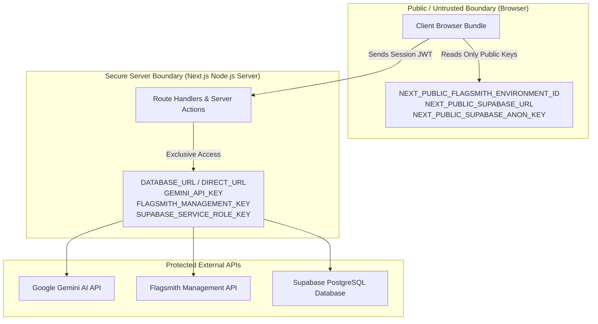

# Security Architecture & Threat Model
## PulsePilot AI — Autonomous Experimentation & Growth Platform
**Hackathon Track:** Flagsmith Toggle Wars — Track 02: AI Agents & Feature Flags  
**Author:** Principal Security Architect & Technical Lead  
**Version:** 1.0.0  

---

## 1. Security Philosophy & Principles

PulsePilot AI adheres to **Defense in Depth**, **Principle of Least Privilege**, and **Zero-Trust AI Automation**:
- **Zero Client-Side Leakage:** No administrative or management API keys are bundled into client JavaScript.
- **Human Gating for Production Changes:** AI cannot autonomously execute live traffic shifts without authenticated human authorization.
- **Immutable Auditability:** Every action, decision, prompt, and flag mutation is logged in an append-only audit trail.
- **Strict Input/Output Schema Enforcement:** Every boundary is fortified with Zod validation.

---

## 2. Secrets Management & Environment Boundary

### Critical Rules:
1. `GEMINI_API_KEY` and `FLAGSMITH_MANAGEMENT_KEY` **must never** have a `NEXT_PUBLIC_` prefix.
2. In client build verification (`npm run build`), Next.js tree-shaking and environment inspection confirm zero private secret leakage.
3. Telemetry ingestion (`/api/telemetry/track`) uses anonymized `distinctUserId` without storing Personally Identifiable Information (PII) such as cleartext email, phone numbers, or passwords.

---

## 3. Threat Model & Mitigations

| Threat Vector | Severity | Vulnerability Description | Mitigation Strategy |
|---|---|---|---|
| **Prompt Injection / Jailbreak** | High | Malicious user input attempting to hijack the agent to output harmful code or bypass guardrails. | System prompts explicitly declare system identity. User inputs are embedded in structured JSON payloads rather than concatenated raw text. Gemini output is strictly parsed via Zod; invalid formats are rejected. |
| **Statistical Hallucination** | Critical | AI fabricating a 99% confidence score or false uplift to trigger a harmful rollout. | LLMs are barred from doing math. Statistics are calculated strictly in pure deterministic TypeScript. The agent receives factual numbers only. |
| **Unauthorized Flag Rollout** | Critical | Attacker calling the rollout API to switch 100% of production traffic to an unapproved variant. | Server-side role verification (`ADMIN` or `EDITOR` required via Supabase Auth JWT) + Human-in-the-Loop signature verification. |
| **Telemetry Flooding / DDoS** | Medium | Script sending millions of fake conversion events to skew experiment results. | Rate limiting per IP/identity, distinct session deduplication, and sanity caps on events per second. |
| **Flagsmith Credential Compromise** | Critical | Exposure of management token allowing full control of all flags. | Secrets stored in secure server environment variables; scoped tokens where available; instant revocation policy. |

---

## 4. Role-Based Access Control (RBAC) Matrix

| Action | Admin | Editor | Viewer | AI Agent |
|---|:---:|:---:|:---:|:---:|
| View Experiments & Metrics | Yes | Yes | Yes | Read-Only |
| Formulate Experiment with AI | Yes | Yes | No | Generates Draft |
| Approve & Deploy Flag to Flagsmith | Yes | Yes | No | Prohibited (HITL) |
| Review AI Rollout Recommendation | Yes | Yes | Yes | Generates Rec |
| Execute 100% Winner Rollout | Yes | Yes | No | Prohibited (HITL) |
| Trigger Emergency Kill-Switch | Yes | Yes | No | Prohibited (HITL) |
| Manage Team & API Settings | Yes | No | No | Prohibited |

---

## 5. Audit Logging Architecture

Every security-sensitive operation executes a transactional write to the `AuditLog` table with:
- `userId` (Authenticated Supabase UID)
- `action` (e.g. `EXPERIMENT_APPROVED`, `ROLLOUT_EXECUTED`, `KILL_SWITCH`)
- `entityId` (Experiment or Flag ID)
- `previousState` & `newState` (Full JSON diff)
- `metadata` (Request IP, User-Agent, Rationale)

Audit records are append-only; no API endpoint permits updating or deleting audit records.

