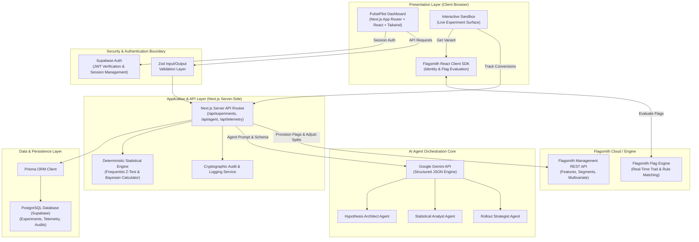
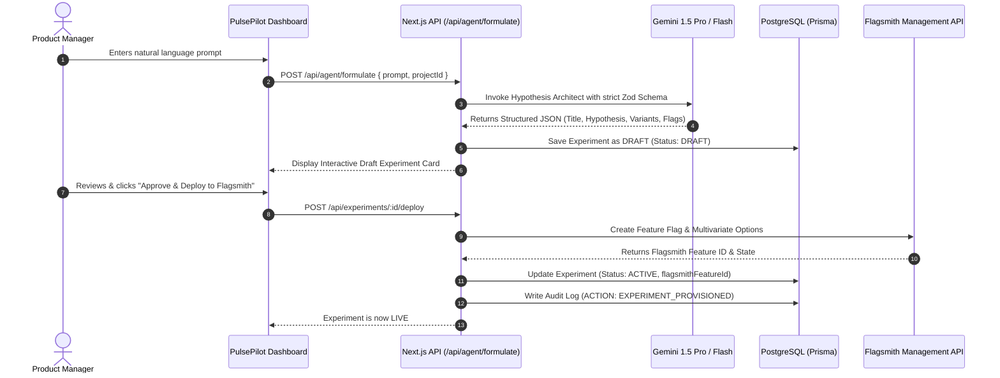
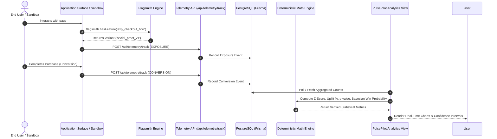
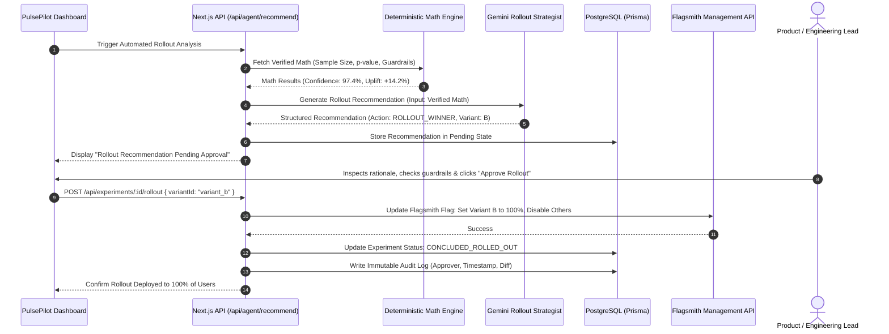

# System Architecture Document
## PulsePilot AI — Autonomous Experimentation & Growth Platform
**Hackathon Track:** Flagsmith Toggle Wars — Track 02: AI Agents & Feature Flags  
**Author:** Principal Architect & Technical Lead  
**Status:** Approved Architecture Draft  
**Version:** 1.0.0  

---

## 1. High-Level Architecture Overview

PulsePilot AI employs a decoupled, modular architecture adhering to zero-trust principles for AI orchestration and feature flag control. The system separates user presentation, client-side flag evaluation, server-side business logic, deterministic mathematical analysis, and AI agent reasoning.

---

## 2. Layered Component Architecture

### 2.1 Presentation Layer (Frontend)
- **Framework:** Next.js (App Router, Server Components where appropriate, Client Components for dynamic interactivity).
- **Styling & UI Kit:** Tailwind CSS with a tailored executive light theme palette, Radix UI primitives / shadcn/ui components, Lucide icons.
- **Data Visualization:** Recharts for Bayesian probability density curves, conversion rates over time, sample accumulation, and uplift confidence intervals.
- **State Management & Data Fetching:** SWR / React Query patterns with optimistic UI updates and instant cache invalidation upon flag actions.
- **Flagsmith React SDK:** Integrated with `FlagsmithProvider` for client-side flag retrieval and traits management.

### 2.2 Security & Authentication Boundary
- **User Authentication:** Supabase Auth handles email/password, magic links, or OAuth sessions via standard JWTs validated in Next.js middleware and route handlers.
- **Authorization & RBAC:** Organization-level and Project-level access controls (`Admin`, `Editor`, `Viewer`). Only `Admin` and `Editor` roles can approve AI-generated rollouts.
- **Secret Isolation:** Environment variables containing Flagsmith Management API Keys, Gemini API Keys, and Database credentials are strictly bound to server-side executions (`process.env.*` without `NEXT_PUBLIC_` prefixes).

### 2.3 Application & API Layer (Next.js Server-Side)
- **API Endpoints:**
  - `/api/experiments`: CRUD for experiments, status transitions, and variant definitions.
  - `/api/agent/formulate`: Triggers the Hypothesis Architect to generate an experiment structure from natural language.
  - `/api/agent/analyze`: Triggers the Statistical Analyst to evaluate current telemetry and generate insight summaries.
  - `/api/agent/recommend`: Triggers the Rollout Strategist to produce canary/winner rollout recommendations.
  - `/api/telemetry/track`: High-throughput ingestion of client exposure and conversion events.
  - `/api/flagsmith/sync`: Bi-directional synchronization with Flagsmith Management API.
  - `/api/audit-logs`: Immutable retrieval of system operations and human approvals.
- **Deterministic Statistical Engine:**
  - Written in TypeScript with zero LLM dependency.
  - Computes standard error ($SE$), Z-score, p-value, 95% Confidence Interval ($CI$), and Bayesian probability to beat control using numerical integration.
  - Outputs fed to agents as strict factual inputs.

### 2.4 AI Agent Orchestration Core
- Uses **Google Gemini** with native structured JSON output and schema enforcement via Zod.
- Agents operate under dedicated system prompts with role-based constraints:
  - **Hypothesis Architect:** Specializes in product psychology, conversion funnels, and feature flag taxonomy.
  - **Statistical Analyst:** Specializes in translating deterministic math into clear executive summaries and risk assessments.
  - **Rollout Strategist:** Specializes in safe deployment policies, progressive traffic ramp-ups (e.g., 5% $\to$ 25% $\to$ 50% $\to$ 100%), and canary safety guardrails.

### 2.5 Flagsmith Cloud Integration
- **Management API:**
  - Provisions feature flags: `FLAG_KEY_EXP_<NAME>`.
  - Sets up multivariate options (e.g., `control` = 50%, `variant_a` = 50%).
  - Configures feature values (JSON payloads containing UI copy, colors, button behaviors, or pricing numbers).
  - Toggles flag states (Enabled / Disabled / Archived).
- **Client SDK:**
  - Instantiated with `FlagsmithProvider` using the public `environmentID`.
  - Identifies users via distinct user keys and user traits (e.g., `plan: "pro"`, `country: "US"`).
  - Evaluates flag values synchronously with zero flicker.

### 2.6 Persistence & Telemetry Layer
- **PostgreSQL via Prisma ORM:**
  - Stores relational metadata: Users, Organizations, Projects, Experiments, Variants, Metrics, Events, Agent Runs, and Audit Logs.
  - Optimized indexes on `experimentId`, `timestamp`, `userId`, and `variantId` to support real-time aggregation queries.

---

## 3. End-to-End Sequence Flows

### 3.1 Natural Language Experiment Creation & Flag Provisioning

### 3.2 Telemetry Tracking & Real-Time Statistical Evaluation

### 3.3 Safe Rollout & Human-in-the-Loop Safeguard

---

## 4. Key Architectural Decisions & Rationale

1. **Why Pure Deterministic Math for Statistics instead of LLM calculation?**
   - *Rationale:* LLMs frequently suffer from arithmetic hallucination, inconsistent p-value rounding, and probabilistic extrapolation errors. By computing statistics through rigorously tested mathematical formulas and passing the resulting numbers to the LLM solely for qualitative analysis and narrative synthesis, we guarantee 100% mathematical integrity.

2. **Why Human-in-the-Loop for Flag Rollouts?**
   - *Rationale:* In enterprise and startup production environments, unattended automated code or flag switching can lead to cascading failures, billing anomalies, or unexpected user friction. Human approval guarantees engineering accountability while leveraging AI for heavy analytical lifting.

3. **Why Flagsmith as the Core Engine?**
   - *Rationale:* Flagsmith is the leading open-source feature flagging and remote config platform. Its separation of Management API vs Client SDK, multivariate evaluation engine, and segment overrides provide an enterprise-grade backbone for our AI agents to actuate changes safely.

